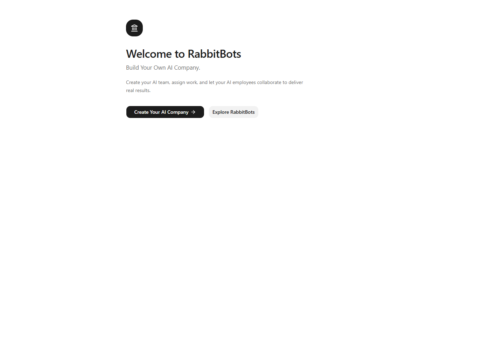
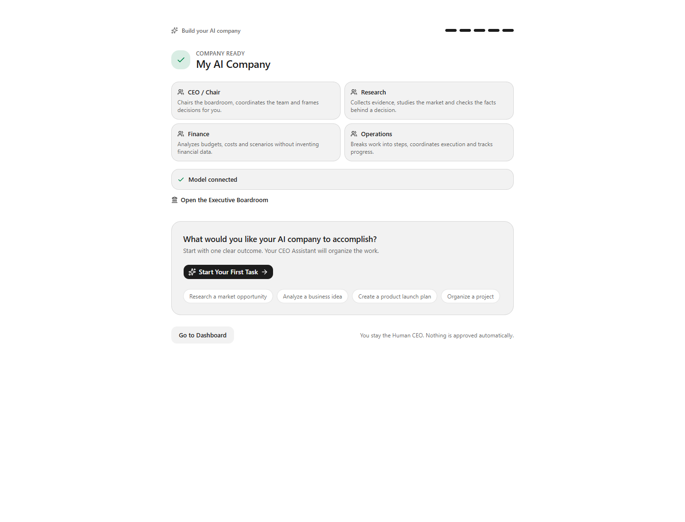
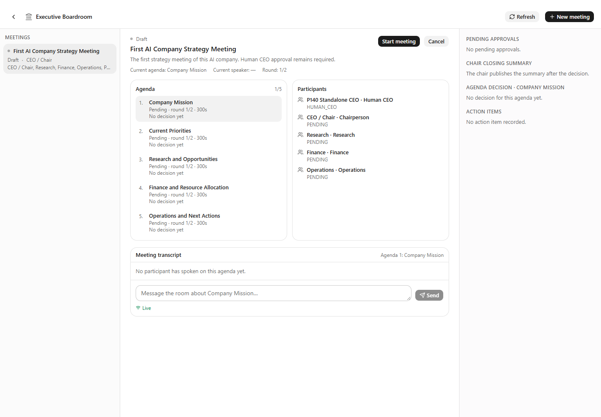
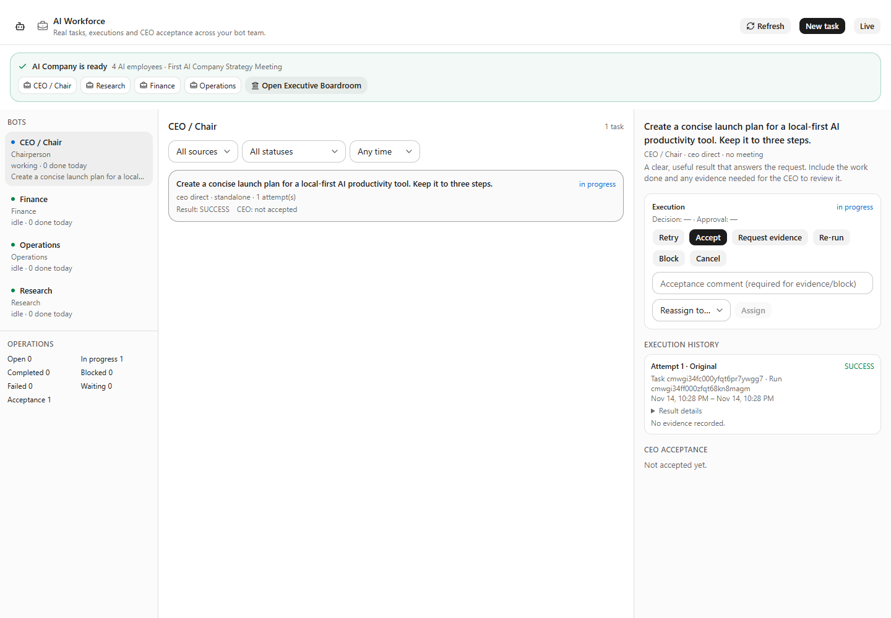
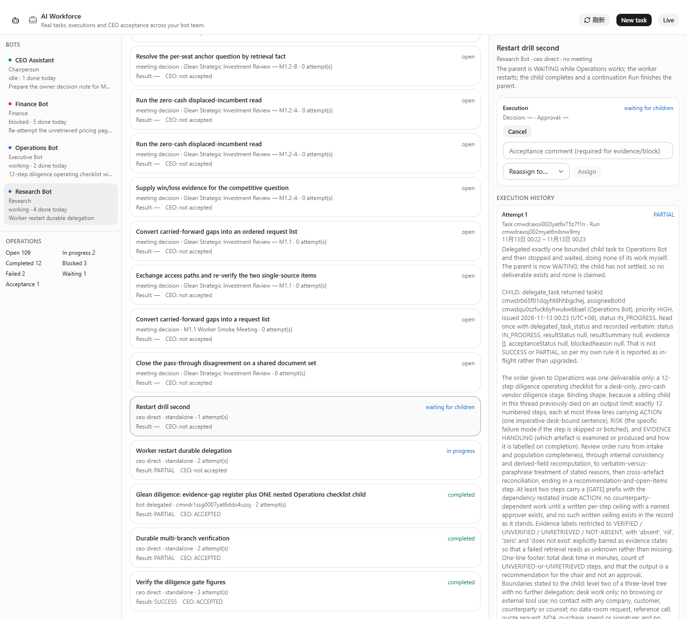
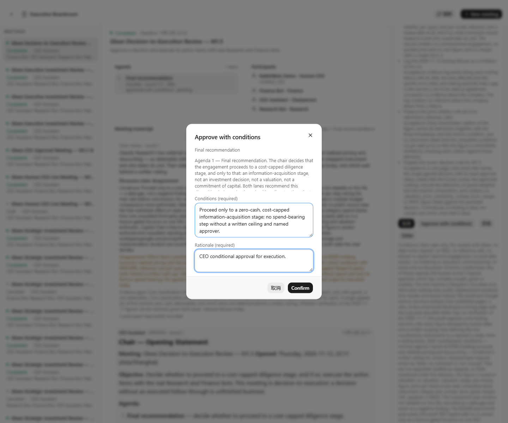
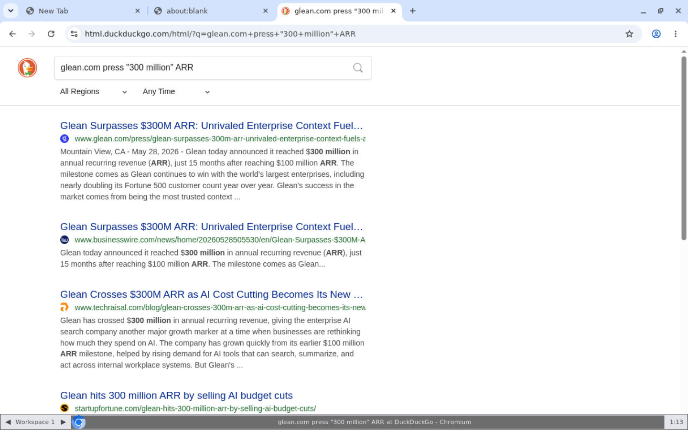

# RabbitBots

**Build Your Own AI Company.**

Open-source AI employees that meet, decide, delegate, use real computers, and deliver work approved by a human CEO.

**[Quick start](#quick-start)** · **[Your first AI Company](#your-first-ai-company)** · **[Architecture](#architecture-overview)** · **[Self-hosting](#self-hosting)** · **[Contributing](#contributing)**

[English](./README.md) | [简体中文](./README.zh-CN.md) | [日本語](./README.ja.md) | [ไทย](./README.th-TH.md)

[](https://github.com/evangel2022/rabbitbots/stargazers)
[](https://discord.gg/RWwKa2Sn7h)
[](https://github.com/evangel2022/rabbitbots/actions/workflows/ci.yml)
[](./LICENSE)
[](https://apps.apple.com/app/rakazo/id6801531099)
[](https://play.google.com/store/apps/details?id=com.rakazo.app)

## What is RabbitBots?

RabbitBots is a self-hosted workspace for running a company of AI employees. Give each bot a role,
put them in an executive meeting, approve the decision, and follow the resulting work through real
tasks, delegation, execution attempts, evidence and CEO acceptance.

Unlike a chatbot, RabbitBots keeps the organization around the work: who decided, who owns the task,
which employee delegated it, what actually ran, what failed, and whether the CEO accepted the result.

> RabbitBots source is developed publicly at https://github.com/evangel2022/rabbitbots. The hosted service, `rakazo.com`, `app.rakazo.com`, existing app store listings, internal `@rakazo/*` package names and `RAKAZO_*` settings remain in place while the brand migration continues.

## Three core capabilities

### Executive Boardroom

AI executives meet, discuss an agenda, disagree with reasons, and produce a decision for the human
CEO. The boardroom records the chair, participants, turn-by-turn discussion, formal minutes,
decisions, conditions and approval history.

- Agenda-based discussions
- Multiple AI roles in one meeting
- CEO approval, rejection and conditional approval
- Formal minutes derived from persisted records

### AI Workforce

Approved decisions become executable tasks instead of promises in a chat. Every task has an owner,
acceptance criteria, priority and due date where applicable.

- Meeting actions and CEO Direct tasks
- Real Task/Run execution
- Immutable execution attempts
- Result, evidence, blocked reason and error history
- CEO acceptance, request for evidence, retry, reject or block

### Autonomous Delegation

An AI employee can delegate work to another employee and wait durably for the result. The parent
does not need to poll a chat or hold a process open.

- `delegate_task` from a real Bot Run
- Parent/child task tree with independent Task/Run/Attempt history
- Durable waiting and automatic continuation
- Self-delegation and ancestor cycles rejected
- Bounded depth and child count
- Timeout, failure and late child results remain visible

## More capabilities

- **Real Computer Use** — give a Bot a browser, terminal, files and a desktop; watch it work or take
  control for a sign-in.
- **Browser Automation** — navigate pages, read snapshots and act through the Bot's computer.
- **Execution History** — unified attempts across meetings and workforce tasks, with results,
  evidence and errors.
- **Retry and Failure Recovery** — re-execute with a new attempt; old attempts are not rewritten.
- **Model Provider Configuration** — use a subscription, an API key or an OpenAI-compatible local
  server; choose a different model per Bot.
- **Self-hosted Deployment** — Docker images for a single machine or a server, with your own
  database, keys and computer provider.

## Product screenshots

These are screenshots from real acceptance runs. They show the current onboarding flow and the team/work surfaces a new developer reaches after startup.

| Welcome                                                                                                                       | Create Your AI Company                                                                                            |
| ----------------------------------------------------------------------------------------------------------------------------- | ----------------------------------------------------------------------------------------------------------------- |
| [](./docs/reports/assets/p150-onboarding-welcome.png) | [](./docs/reports/assets/p150-company-ready.png) |

| Executive Boardroom                                                                                          | AI Workforce                                                                                          |
| ------------------------------------------------------------------------------------------------------------ | ----------------------------------------------------------------------------------------------------- |
| [](./docs/reports/assets/p150-boardroom.png) | [](./docs/reports/assets/p150-workforce.png) |

| Durable delegation                                                                                                                | CEO approval and acceptance                                                                                                |
| --------------------------------------------------------------------------------------------------------------------------------- | -------------------------------------------------------------------------------------------------------------------------- |
| [](./docs/reports/assets/phaseM18-waiting.png) | [](./docs/reports/assets/phaseM15-approval.png) |

| Real Computer / Browser Use                                                                                                                                     |
| --------------------------------------------------------------------------------------------------------------------------------------------------------------- |
| [](./docs/reports/assets/phase1f-computer-screen-1440.png) |

## Quick start

### Option A — published Docker images

This is the fastest path for a server or a local Docker host. It needs Docker Engine, the Compose plugin, `curl` and `openssl`; it does not need Node.js.

```bash
mkdir -p rabbitbots && cd rabbitbots &&
curl -fsSLO https://raw.githubusercontent.com/evangel2022/rabbitbots/main/infra/compose/install-images.sh &&
bash install-images.sh
```

The installer downloads the Compose files, creates `.env` with random secrets, and starts the stack. It preserves an existing `.env` when rerun. Open the URL printed by the installer (normally [http://127.0.0.1:5173](http://127.0.0.1:5173)).

For a server, run `bash install-images.sh --prepare-only`, edit the generated `.env`, then run the installer again. The [self-hosting guide](./docs/self-host.md) covers HTTPS, backups, upgrades and computer providers.

> Published images follow the release/edge build and may not contain unmerged source changes. Use the source checkout below when trying the current `main` worktree.

> Verification boundary: the source checkout path below is the path verified in this repository's current test environment (WSL2, Node 26, pnpm 12, Docker). The published-image installer syntax and local `--prepare-only` preparation are checked, but a full image pull/start is not verified here. Windows native is not a supported, tested path; use WSL2.

### Option B — source checkout in WSL or Linux

Requirements:

- Node.js **24.15.0+ in the 24.x line, or Node.js 26+**. Node.js 25.x is not supported.
- pnpm **12.18.0**.
- Docker, for the local Postgres container and optional computer sandboxes.
- Windows: use WSL2 Ubuntu and run the commands in the Linux shell. Docker Desktop must have WSL integration enabled. Native Windows is not a tested development path.

```bash
git clone https://github.com/evangel2022/rabbitbots.git
cd rabbitbots
cp .env.example .env
```

For a local trial, let `pnpm dev` own Postgres instead of pointing at a database server:

```bash
# In .env: leave DATABASE_URL and DATABASE_MIGRATION_URL empty so pnpm dev starts its local Postgres.
# Set independent random values for these required secrets:
#   BETTER_AUTH_SECRET, ENCRYPTION_KEY, SCREEN_PROXY_SECRET, SANDBOX_SUPERVISOR_TOKEN
# Example (run in the repository root; never commit .env):
# BETTER_AUTH_SECRET=$(openssl rand -hex 32)
# ENCRYPTION_KEY=$(openssl rand -hex 32)
# SCREEN_PROXY_SECRET=$(openssl rand -hex 32)
# SANDBOX_SUPERVISOR_TOKEN=$(openssl rand -hex 32)

pnpm install --frozen-lockfile
pnpm dev
```

`pnpm dev` starts the API, worker, web app, sandbox supervisor and a reusable local Postgres container, applies migrations and prints the web URL (normally [http://127.0.0.1:5173](http://127.0.0.1:5173)). If the default block is busy, use the URL it prints.

This source path was verified from a clean clone in WSL2 with Node.js 26.13.0, pnpm 12.18.0 and Docker: `pnpm install --frozen-lockfile` completed, and `pnpm dev` brought up API and Web with HTTP 200 and applied the database migrations.

For an existing Postgres server, set `DATABASE_MIGRATION_URL` and `DATABASE_URL` in `.env` instead of leaving them empty. The full references are:

- [Self-hosting](./docs/self-host.md)
- [Configuration](./docs/self-host-configuration.md)
- [Docker computers](./docs/self-host-docker-computers.md)
- [Backups](./docs/self-host-backups.md)
- [Upgrades](./docs/self-host-upgrading.md)
- [Production deployment](./docs/self-host-production.md)

To use real Docker computers, build the local sandbox image after `pnpm dev` works:

```bash
pnpm sandbox:build
```

### Windows note

Use WSL2 with Docker Desktop integration. Run `git`, `pnpm` and Docker commands inside the WSL shell, not in a native PowerShell checkout. Native Windows is not claimed as tested by this README.

## Your first AI Company

After startup, open the printed URL and create an account. The first-run path is:

1. **Welcome** — choose **Create Your AI Company**.
2. **Company Profile** — enter a name (and an optional description); the default is a safe placeholder.
3. **Build Your AI Team** — keep the four default employees (CEO / Chair, Research, Finance, Operations), or rename them and adjust their responsibilities.
4. **Connect Your AI Model** — use **Find models / test connection**, or skip for now. Skipping leaves the Company ready but disables task execution until a model is connected.
5. **Create Your AI Company** — this is the explicit write action. It creates one Company profile, four AI Employees and a draft Executive Boardroom. Repeating it is idempotent and does not duplicate Bots.
6. **Start Your First Task** — describe an outcome. RabbitBots creates a real Workforce task, assigns it to the CEO / Chair employee and starts the existing Worker path. If the task needs a site or an irreversible action, the existing approval rules still apply.
7. Follow the result in **AI Workforce**. The result remains `CEO: not accepted` until the human CEO accepts it; **Open the Executive Boardroom** shows the meeting and approval surface.

If a model is not connected, the task form tells you to connect one. It does not create a task or report a fake success. The first task is real: it appears in Workforce with its Task/Run history and still obeys CEO acceptance rules.

## Demo guide

The demo seed is a source-checkout tool. It creates a **CEO Assistant**, **Research Bot** and
**Finance Bot** in a demo account; add an Operations Bot from the normal Bot picker if you want a
fourth role.

If you followed the source quick start and `pnpm dev` is running, seed the demo account from
another terminal:

```bash
node scripts/rabbitbots-demo-seed.mjs
```

The script prints the demo email and password once. It is safe to rerun and reuses Bots by
`spawnKey` or name. Open the printed URL, sign in, and use the normal AI Company / Boardroom / AI
Workforce flow.

Useful checks:

- A meeting needs at least two Bots; the seeded account has three.
- A conditional decision cannot execute until the CEO confirms the conditions.
- A failed or timed-out child does not make the parent successful; the parent still needs CEO
  acceptance.
- A refresh must preserve the Task, Run, Attempt and acceptance history.

## Architecture overview

RabbitBots is a pnpm/Turbo monorepo:

- `apps/web` — React/Vite workspace UI, including Boardroom and AI Workforce.
- `apps/api` — Hono/oRPC API and session-scoped routes.
- `apps/worker` — Graphile Worker runtime for runs, meetings and reconciliation.
- `apps/desktop`, `apps/mobile` — clients sharing the API and contracts.
- `packages/contracts` — shared Zod contracts and RPC definitions.
- `packages/db` — Prisma schema and migrations.
- `packages/adapters` — meeting, workforce, executor, computer and integration adapters.
- `packages/core` — runtime, run lifecycle and approval primitives.
- `infra` — Compose, sandbox supervisor and deployment assets.

The core execution path is:

```text
Meeting decision -> CEO approval -> MeetingActionItem
                                  -> real Task/Run
                                  -> ExecutionAttempt
                                  -> CEO acceptance

CEO Direct Task -> real Task/Run -> ExecutionAttempt
                                  -> CEO acceptance

Bot Run -> delegate_task -> child WorkforceTask -> child Task/Run
                         -> durable delegation -> continuation Run
                         -> parent result -> CEO acceptance
```

Key implementation files:

- Meeting lifecycle: `packages/adapters/src/meetings.ts`
- Workforce and delegation: `packages/adapters/src/workforce-tasks.ts`
- Runtime and worker: `packages/adapters/src/executor.ts`,
  `packages/adapters/src/run-lifecycle.ts`
- Unified attempts: `packages/adapters/src/execution-attempts.ts`
- Boardroom UI: `apps/web/src/pages/MeetingsPage.tsx`
- Workforce UI: `apps/web/src/pages/WorkforcePage.tsx`

See [docs/run-execution.md](./docs/run-execution.md) for the run lifecycle and
[docs/getting-started.md](./docs/getting-started.md) for the onboarding path.

## Model configuration

You can connect a model during onboarding, or later in **Settings → Models**.

A model is required before the first task can run. If you skip model setup, RabbitBots keeps the Company and explains that a model is needed; it does not fake a successful task.

Supported paths:

- Sign in with a Claude or ChatGPT subscription.
- Connect an API key for OpenAI, Anthropic, Google, OpenRouter and other providers.
- Connect an OpenAI-compatible server such as Ollama, LM Studio or a self-hosted model, with an explicit base URL, model id and optional API key. The connection form performs a real server probe/test before saving.

### Local OpenAI-compatible model

For an Ollama server running next to a **source checkout**, use the exact model id from
`ollama list` and a URL the API and worker processes can reach, for example:

```text
Server URL: http://127.0.0.1:11434/v1
Model id:   llama3.2
```

Local and private endpoints are refused by default. On both API and Worker set:

```text
MCP_ALLOW_PRIVATE_ENDPOINT=true
```

Then restart both services. Setting only one leaves either the connection probe or the task run
failing. This flag allows private model endpoints for every user of the deployment, so enable it
only when the endpoint is one you control.

The boundary depends on where the processes run:

- **Source checkout in WSL/Linux:** `127.0.0.1` means that WSL/Linux environment. If Ollama runs on
  Windows instead, use a Windows-host address reachable from WSL rather than the WSL loopback.
- **Published Docker images:** inside the API and worker containers, `127.0.0.1` is the container
  itself. Use a host address reachable from the container, such as
  `http://host.docker.internal:11434/v1` on Docker Desktop/WSL2, or a bridge-reachable host address
  on Linux.

See [self-hosted models](./docs/self-host-models.md) for the full private-endpoint rules.

Each Bot can use its own model and thinking level. See [docs/models.md](./docs/models.md). Deployment-wide model inheritance is optional; a new user can configure their own model without one.

## Self-hosting

The source checkout needs **Node.js 24.15.0 or newer** in the 24.x line, or Node.js 26+, plus
**pnpm 12** and **Docker**. Node.js 25.x is not supported.

```bash
git clone https://github.com/evangel2022/rabbitbots.git
cd rabbitbots
cp .env.example .env
```

Set `POSTGRES_PASSWORD` and `POSTGRES_APP_PASSWORD` to independent `openssl rand -hex 16` values and
put them in `DATABASE_MIGRATION_URL` and `DATABASE_URL`. Set `BETTER_AUTH_SECRET`, `ENCRYPTION_KEY`
and `SCREEN_PROXY_SECRET` to independent random values. Docker sandboxes also need a dedicated
`SANDBOX_SUPERVISOR_TOKEN`.

```bash
pnpm install
pnpm db:generate
pnpm db:migrate
pnpm sandbox:build
pnpm dev
```

The full references are:

- [Self-hosting](./docs/self-host.md)
- [Configuration](./docs/self-host-configuration.md)
- [Docker computers](./docs/self-host-docker-computers.md)
- [Backups](./docs/self-host-backups.md)
- [Upgrades](./docs/self-host-upgrading.md)
- [Production deployment](./docs/self-host-production.md)

Desktop and mobile clients connect to the same API. See
[docs/desktop-app.md](./docs/desktop-app.md) and [docs/mobile-app.md](./docs/mobile-app.md).

## Contributing

Contributions are welcome. Read [CONTRIBUTING.md](./CONTRIBUTING.md) before opening a PR.

```bash
pnpm test
pnpm test:integration
pnpm test:e2e
pnpm check
pnpm lint
```

Report vulnerabilities privately through [SECURITY.md](./SECURITY.md), not a public issue.

## Community and roadmap

- [Contributing guide](./CONTRIBUTING.md)
- [Security policy](./SECURITY.md)
- [Changelog](./CHANGELOG.md)
- [Open issues and roadmap discussion](https://github.com/evangel2022/rabbitbots/issues)
- [Discord community](https://discord.gg/RWwKa2Sn7h)

Issue and pull-request templates live under [.github](./.github). Pull requests should describe the problem, the behavior change, how it was tested, and any migration or risk.

## License

RabbitBots is available under the [Apache License 2.0](./LICENSE). The license covers the source code;
the RabbitBots name and marks are not granted by the source license.

The public website is in `apps/www`. The product documentation is in `docs/`.
