# RabbitBots Phase 1B — Brand Identity & Three-Column Workspace

> 实施报告。基于 HEAD `6c7e1bcc6`，只改 Web 产品面与演示数据准备；未改 Agent Runtime、Computer Runtime、API 协议、数据库 Schema、Prisma 迁移或依赖，未 commit / push。

## 1. 元信息

| 项 | 值 |
| --- | --- |
| 仓库 | RabbitBots（Rakazo monorepo） |
| 基线 | `6c7e1bcc6`（`main`） |
| 运行环境 | WSL Ubuntu 20.04 + Node 26.13（nvm）+ pnpm 12.18；dev stack：web `5173`、api `3100`、supervisor `7091`、Postgres `55450` |
| 演示账号 | 由 `scripts/rabbitbots-demo-seed.mjs` 创建；三个 bot：CEO Assistant / Research Bot / Finance Bot |
| 浏览器验证 | Windows Chrome 1440×900、1280×800、1024×768、390×844；light + English |
| 提交状态 | 未 commit / push；`scripts/dev.mjs` 的既有端口修改保持原样 |

演示账号的密码由 seed 脚本在本地打印，**不写入仓库、不写入本报告**。

## 2. 交付结果与验收

| 验收项 | 状态 | 依据 |
| --- | --- | --- |
| 浏览器标题与主要品牌显示 RabbitBots | ✅ | `document.title = "RabbitBots"`；侧栏 wordmark；登录页 “Sign in to RabbitBots” |
| 左侧同时展示三个预置 Bot | ✅（演示账号） | 截图与浏览器断言；三个 bot 由 seed 脚本通过公开 RPC 创建 |
| 可以切换三个 Bot | ✅ | 依次点击 CEO Assistant / Research Bot / Finance Bot，聊天与右栏同步切换 |
| 中间聊天功能正常 | ✅（UI/单测，未做真实模型发送） | 消息列表、输入框、发送逻辑未改；完整单测通过；浏览器中三个对话独立加载 |
| 不同 Bot 聊天上下文不串线 | ✅ | 切到 Research 后 transcript 含 Research 文案、不含 CEO 文案；切回 CEO 仍显示 CEO 对话 |
| 右侧 Computer Workspace 常驻显示 | ✅（≥1280px 默认打开） | 1440/1280 截图；可折叠为 48px rail；设置面板临时替换，关闭后恢复 |
| 未启动时显示真实空状态 | ✅ | 显示 API 返回的 `Stopped` + `Start`；点击 `Start` 调真实 `computer/boot` |
| 桌面端三栏完整 | ✅ | 1440/1280 截图；1024 退化为两栏，右栏隐藏 |
| 移动端基本聊天正常 | ✅ | 390×844 聊天与侧栏抽屉截图 |
| 现有相关测试通过 | ✅（单测/类型/构建） | 226 个文件、2018 个测试通过；`tsc` 通过；生产构建通过 |
| 文件清单、测试结果、截图 | ✅ | 本报告 |

## 3. 修改前后对比

### 3.1 工作台

| 修改前 | 修改后 |
| --- | --- |
| 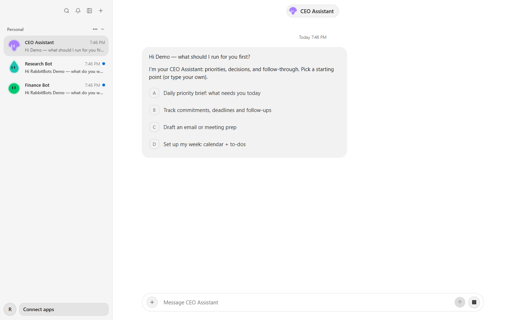 | 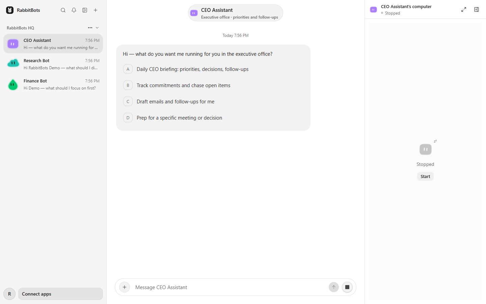 |

修改前：侧栏、聊天两栏；右侧空白；Computer 隐藏在聊天标题 → 设置面板 → Computer Tab 之后，或全屏 Overlay。
修改后：侧栏、聊天、Computer Workspace 三栏；右侧显示当前 bot 的电脑状态与真实空态，聊天标题下显示该 bot 的角色说明。

### 3.2 品牌

| 修改前 | 修改后 |
| --- | --- |
| 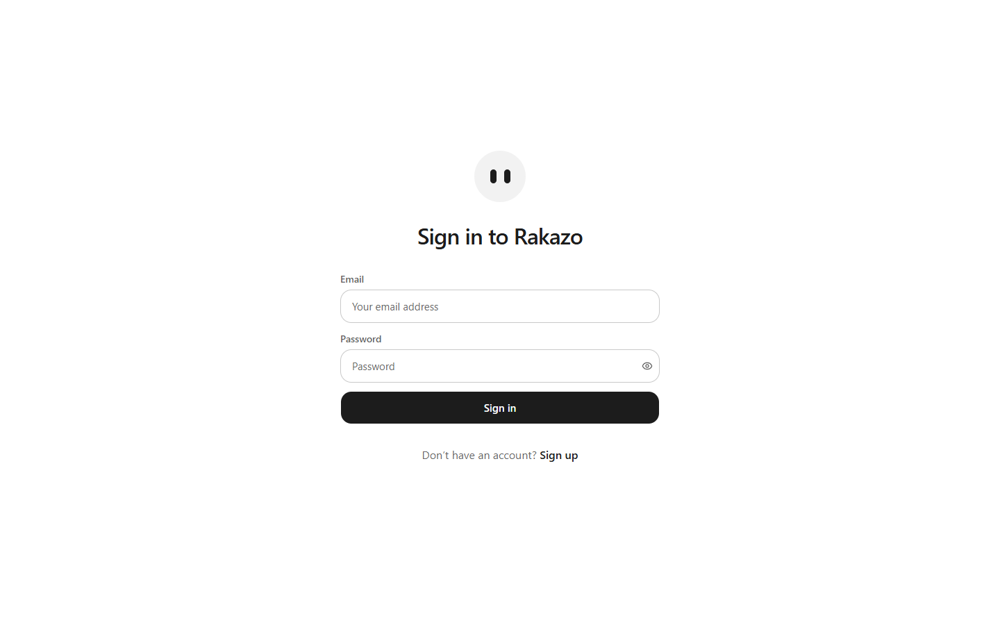 | 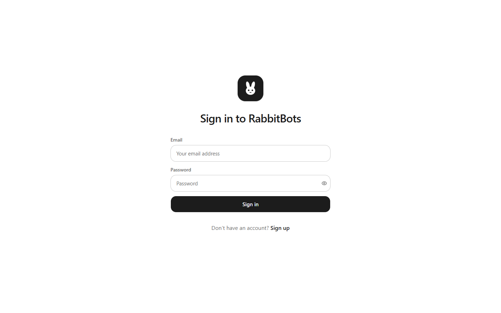 |

- 登录页图形从两根竖条改为 RabbitBots 兔子标；标题改为 “Sign in to RabbitBots”。
- 浏览器 favicon / PWA 图标改为白兔 on ink 圆角方块。
- 侧栏顶部新增 RabbitBots wordmark（22px 标 + 品牌字）。
- 中文界面同步为 “登录 RabbitBots”，证明 15 份翻译 catalog 已同步更新：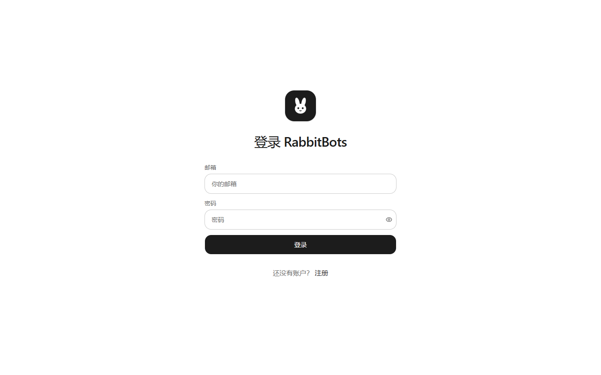。

### 3.3 Bot 切换与聊天独立

| CEO Assistant | Research Bot | Finance Bot |
| --- | --- | --- |
|  | 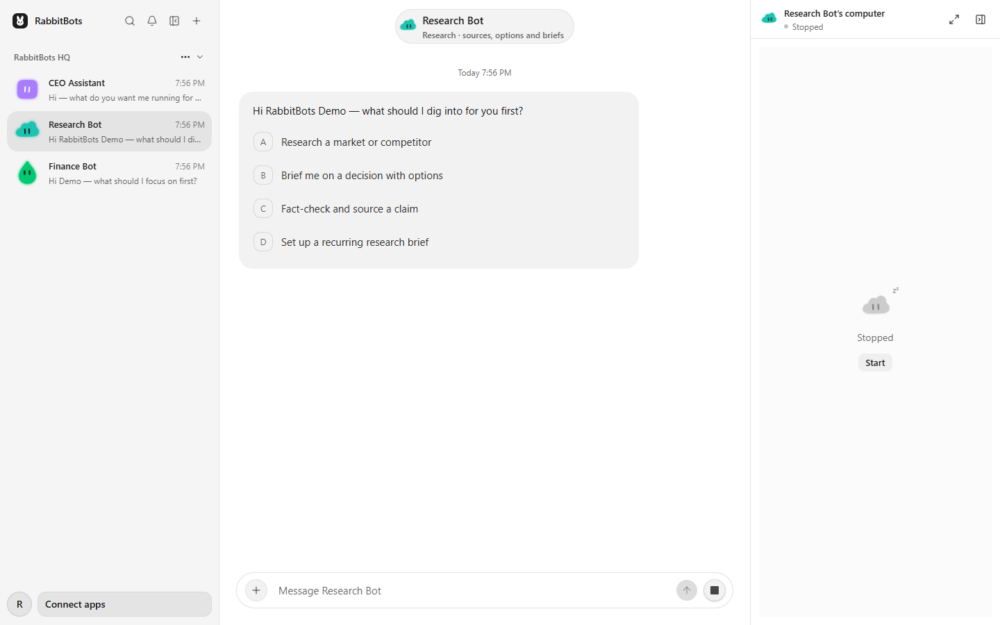 | 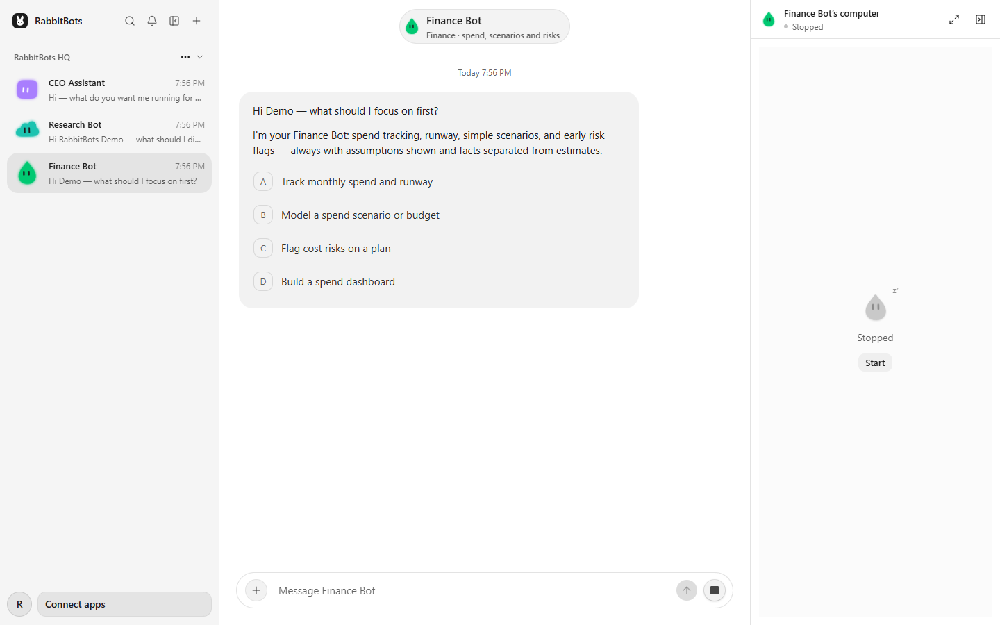 |

三个 bot 各有独立 thread、独立 draft key、独立右栏记忆；切换后标题、角色说明、对话、Computer 标题一起切换。浏览器断言：Research 页面包含 Research 文案且不包含 CEO 文案。

### 3.4 响应式

| 1280px：三栏 | 1024px：两栏（右栏隐藏） | 390px：移动聊天 | 390px：侧栏抽屉 |
| --- | --- | --- | --- |
| 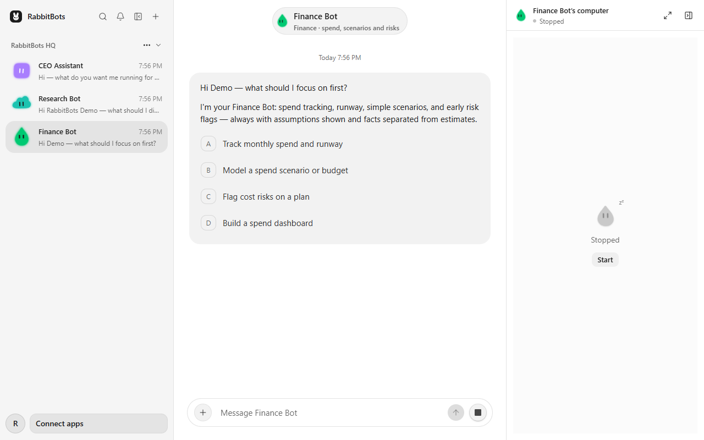 | 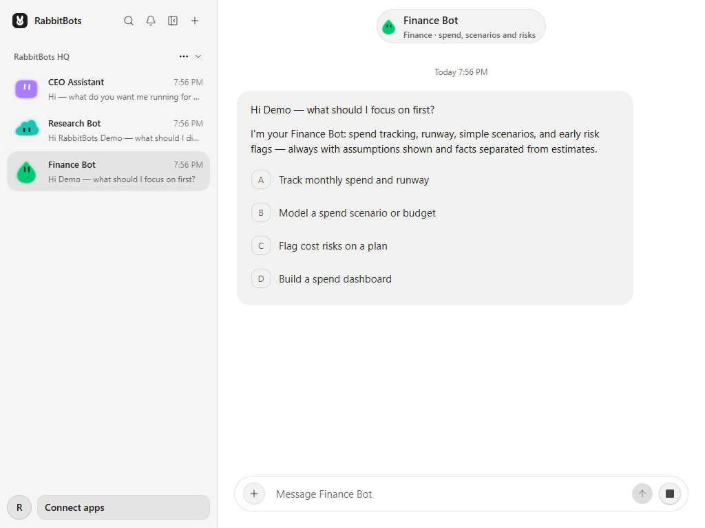 | 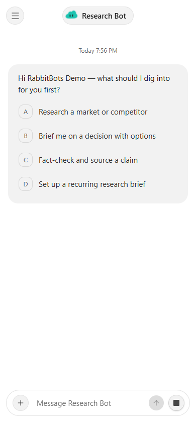 | 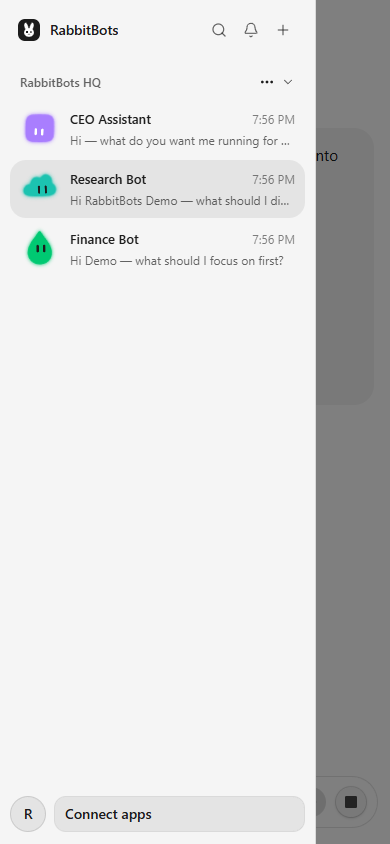 |

- ≥1280px：三栏同时可见，右栏默认 360px（2xl 400px）。
- 1024–1279px：右栏隐藏，保留既有 “设置 → Computer” 和全屏 Computer 入口。
- <768px：左栏为抽屉，右栏隐藏；聊天与 composer 保持原有行为。
- 折叠右栏后保留 48px rail，点击即可恢复：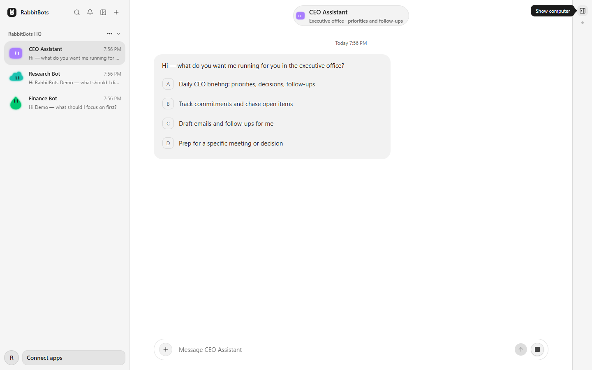。
- 打开聊天设置时右栏临时替换为设置面板，关闭后恢复：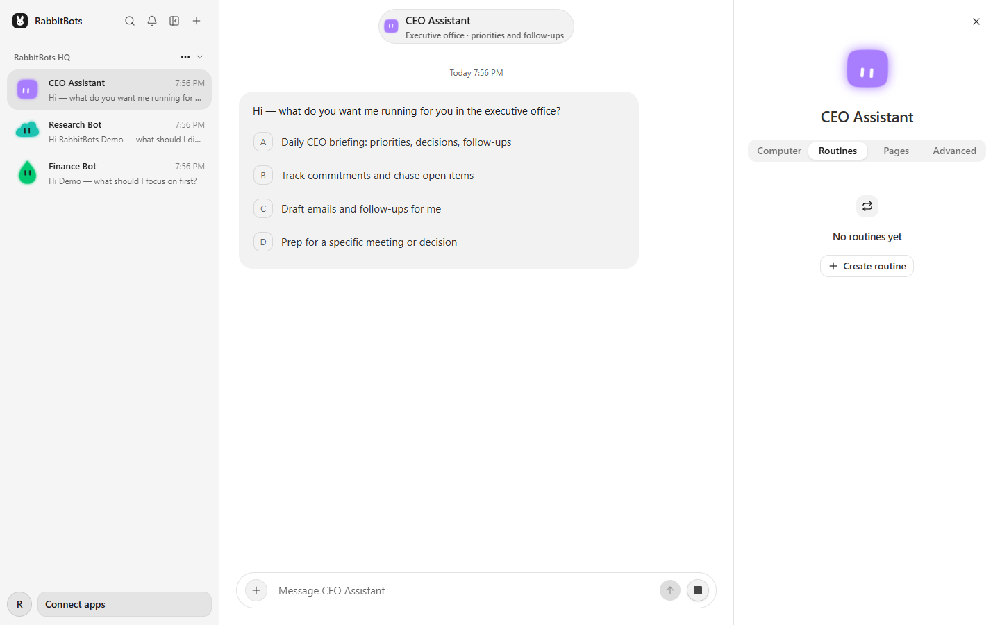、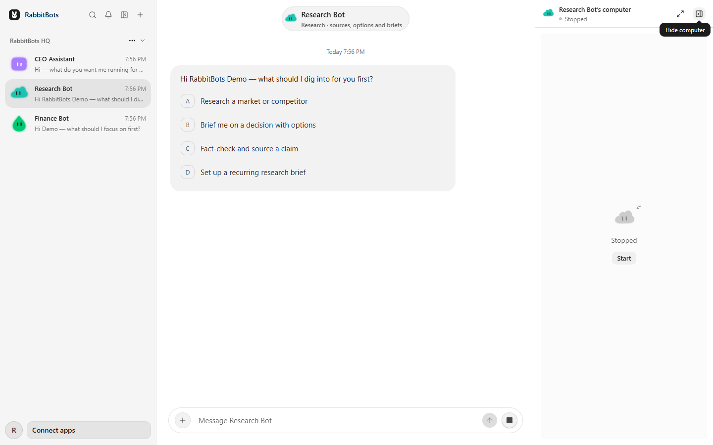。

## 4. 实施细节

### 4.1 品牌替换（Web）

- `apps/web/index.html`：`<title>RabbitBots</title>`、`application-name`、`apple-mobile-web-app-title`、description、`theme-color #ffffff`，新增 `/favicon.svg` 链接。
- `apps/web/src/pwa/plugin.ts`：manifest `name` / `short_name` 改为 `RabbitBots`，description 改为 “Three AI teammates for the executive office.”。
- 新增 `apps/web/src/components/RabbitBotsBrand.tsx`：`RabbitBotsMark`（兔子头，`currentColor` + `fill-foreground` 眼/嘴）与 `RabbitBotsWordmark`（ink 底板 + 名称）。
- `apps/web/src/pages/shell/sidebar-header.tsx`：在 72px 窗口控制占位之后渲染 wordmark；浏览器无 Electron 窗口控制时不再渲染空白 spacer。Electron macOS 下只显示标，避免 316px 侧栏拥挤。
- `apps/web/src/pages/Auth.tsx`：74px 登录标改为 `RabbitBotsMark`；标题改为 “Sign in to RabbitBots” / “Create your RabbitBots”。
- 用户可见文案统一替换：`Open RabbitBots`、`Return to RabbitBots`、`Welcome to RabbitBots`、`How will you use RabbitBots?`、`What do you most want RabbitBots to help with?`、`Enjoying RabbitBots?`、`Choose how to use RabbitBots`、`Use RabbitBots credits`、`RabbitBots credits`、`Original / RabbitBots` 头像风格标签、agent import 的 “Not used/supported in RabbitBots”、模型连接说明、dictation 权限说明等。
- 徽标资源：`apps/web/public/favicon.svg`、`rabbitbots-icon.svg`；由这两个 SVG 生成 `favicon-16x16.png`、`favicon-32x32.png`、`favicon.png`、`favicon.ico`、`apple-touch-icon.png`、`icon-192.png`、`icon-512.png`。
- 翻译：`apps/web/src/locales/*/messages.po` 15 份 catalog 共 633 处 `Rakazo → RabbitBots`，保留既有译文（中文登录页已验证）。
- 核心/API 文案：`packages/core/src/run-error.ts` 与 `apps/web/src/lib/run-error.ts` 的 “Rakazo credits” 改为 “RabbitBots credits”；`apps/api/src/routes/context.ts` 的 “Uses Rakazo credits” 改为 “Uses RabbitBots credits”。
- 未改：`apps/desktop` 的 setup/menu/productName、`apps/mobile/app.json`、`apps/www` 营销站、`packages/auth` 的密码重置/欢迎邮件、`packages/core` 的 self-update/secrets 服务端提示、内部包名/env/存储 key/`rakazo-shared` peer id。这些属于其他发布面或内部协议，见 §7。

### 4.2 三栏工作台

- 新增 `apps/web/src/pages/shell/computer-workspace.tsx`：
  - `ComputerWorkspace`：常驻右栏，header 显示 bot 头像、`computerLabel()`、真实状态（Live / Starting / Asleep / Stopped / Unavailable / Error）、`Take control`（running 且未持有控制时）、全屏、隐藏按钮。
  - `ComputerWorkspaceRail`：折叠后的 48px rail + 运行状态点 + “Show computer”。
  - 复用 `ComputerPanel`，不复制 iframe / 屏幕协议。
- `apps/web/src/pages/shell/computer-panel.tsx`：
  - 新增 `variant: "preview" | "workspace"`；workspace 填满列高，不再固定 16:10。
  - 新增 `onStart`：在 workspace 内直接唤醒/启动，不打开全屏。
  - idle 状态按真实状态显示 `Not started` / `Stopped` / `Asleep`，按钮对应 `Start` / `Wake`。
  - 运行中仍是只读屏幕；交互走 `Take control` → 全屏 Overlay。
- `apps/web/src/pages/shell/use-computer.tsx`：
  - `useComputerState` 新增 `workspaceVisible`，并入 `computerVisible`，使常驻栏获得实时屏幕刷新。
  - `useComputerControls` 新增 `startComputer(botId?)`：调用真实 `computer.boot`，不设置 `computerOpen`。
- `apps/web/src/pages/Shell.tsx`：
  - 宽屏（`useMinWidth(1280)`）+ 有 active bot + 非群聊 + 右栏未打开时渲染 workspace；偏好持久化在 `rabbitbots:computer-workspace`。
  - 原 “Panel = computer” 恢复逻辑在宽屏自动关闭，交给常驻栏；窄屏仍保留 Computer Tab 作为入口。
  - workspace 打开时主动刷新屏幕；设置面板打开时 workspace 卸载，关闭后恢复。
  - 群聊（`/app/g/:groupId`）不渲染 workspace，保持群设置行为。
- 新增 `apps/web/src/lib/computer-workspace-pref.ts`（open/closed 偏好）与 `apps/web/src/lib/use-min-width.ts`（matchMedia hook）。
- `apps/web/src/pages/shell/chat-header.tsx`：标题下显示 `active.description`（`sm+`，截断），即 bot 的角色说明。
- 断点与宽度：
  - ≥1280：左栏 316 + 右栏 360 + 聊天；1440 下聊天约 764px。
  - 1024–1279：两栏。
  - <768：移动抽屉；聊天与 composer 不变。
- 没有改动 `Transcript` / `Composer` / thread / draft / SSE 协议。

### 4.3 演示账号与三个预置 Bot

- 新增 `scripts/rabbitbots-demo-seed.mjs`（无依赖，Node 22+）：
  - 注册或登录演示账号；
  - 调用 `rpc/me` 触发 space bootstrap；
  - 将 space 改名为 `RabbitBots HQ`；
  - 通过 `bots/create` 创建三个 bot（固定 `spawnKey` `rabbitbots:ceo/research/finance`，`computerMode: "dedicated"`），重复运行会复用；
  - 打印 email / password / app URL，不写盘。
- Bot 仍是数据驱动：Roster 继续从 `spaces.list()` 读取，没有把三个名字写进组件；没有改数据库 schema。
- 说明：普通新注册仍走既有 onboarding 并自动创建 “Chief”。为不破坏依赖 “Chief” 的大量 e2e，本阶段没有改 onboarding；演示账号由 seed 脚本预置三个 bot。见 §7 第 1 条。

## 5. 实际修改文件清单

### 5.1 新增

- `apps/web/src/components/RabbitBotsBrand.tsx`
- `apps/web/src/lib/computer-workspace-pref.ts`
- `apps/web/src/lib/use-min-width.ts`
- `apps/web/src/pages/shell/computer-workspace.tsx`
- `apps/web/src/pages/shell/computer-workspace.test.tsx`
- `apps/web/public/favicon.svg`
- `apps/web/public/rabbitbots-icon.svg`
- `scripts/rabbitbots-demo-seed.mjs`
- `docs/reports/RABBITSBOTS-PHASE-1B-IMPLEMENTATION.md`（本文件）
- `docs/reports/assets/*.png`（修改前后截图，见 §3）

### 5.2 修改（Web 源码 / 资源）

- `apps/web/index.html`
- `apps/web/public/favicon.ico`、`favicon.png`、`favicon-16x16.png`、`favicon-32x32.png`、`apple-touch-icon.png`、`icon-192.png`、`icon-512.png`
- `apps/web/src/pages/Shell.tsx`
- `apps/web/src/pages/Auth.tsx`
- `apps/web/src/pages/AccountSettingsOverlay.tsx`
- `apps/web/src/pages/Invite.tsx`
- `apps/web/src/pages/McpOAuthCallback.tsx`
- `apps/web/src/pages/SharedPage.tsx`
- `apps/web/src/pages/SlackInstallCallback.tsx`
- `apps/web/src/pages/memory-providers/HonchoSettingsForm.tsx`
- `apps/web/src/pages/model-settings/compatible-model-fields.tsx`
- `apps/web/src/pages/model-settings/connection-controls.tsx`
- `apps/web/src/pages/onboarding/use-onboarding-model.ts`
- `apps/web/src/pages/shell/agent-import-plan.tsx`
- `apps/web/src/pages/shell/avatar-studio-popover.tsx`
- `apps/web/src/pages/shell/chat-header.tsx`
- `apps/web/src/pages/shell/computer-panel.tsx`
- `apps/web/src/pages/shell/import-status.ts`
- `apps/web/src/pages/shell/sidebar-header.tsx`
- `apps/web/src/pages/shell/use-computer.tsx`
- `apps/web/src/pwa/plugin.ts`
- `apps/web/src/components/GitHubStarPrompt.tsx`
- `apps/web/src/components/ModelCredits.tsx`
- `apps/web/src/components/SignupSurvey.tsx`
- `apps/web/src/components/SubscriptionGate.tsx`
- `apps/web/src/components/pages/PublicPageShell.tsx`
- `apps/web/src/lib/dictation.ts`
- `apps/web/src/lib/run-error.ts`
- `apps/web/src/locales/{de,en,es,fr,he,hi,ja,ko,nl,pl,pt-BR,ru,tr,zh-CN,zh-TW}/messages.po`

### 5.3 测试（更新）

- `apps/web/src/pages/shell/computer-panel.test.tsx`（真实 idle 状态 + Start/Wake）
- `apps/web/src/pages/shell/computer-workspace.test.tsx`（新增）
- `apps/web/src/pages/shell/chat-header.test.tsx`（未改，回归通过）
- `apps/web/src/pages/shell/avatar-studio-popover.test.tsx`（标签）
- `apps/web/src/pages/shell/create-bot-dialog.test.tsx`（文案）
- `apps/web/src/lib/i18n-catalog.test.ts`（新 msgid）
- `apps/web/src/lib/desktop-speech.test.ts`（新文案）
- `apps/web/src/lib/index-html-theme.test.ts`（静态 theme-color 改为 light）
- `apps/web/e2e/helpers.ts`
- `apps/web/e2e/auth-lifecycle.spec.ts`
- `apps/web/e2e/onboarding-signup-survey.spec.ts`
- `apps/web/e2e/onboarding-model-required.spec.ts`
- `apps/web/e2e/pages.spec.ts`
- `apps/web/e2e/agent-import.spec.ts`
- `apps/web/e2e/settings-shell.spec.ts`
- `apps/web/e2e/billing-paywall.spec.ts`
- `apps/web/e2e/avatar-studio.spec.ts`
- `apps/web/e2e/teach-task.spec.ts`（Wake/Start）

### 5.4 核心 / API

- `packages/core/src/run-error.ts`
- `apps/api/src/routes/context.ts`

### 5.5 既有、未触碰

- `scripts/dev.mjs`：Postgres 端口 `54318 → 55450`，保持原样。
- 37 个 `.sh` / `.py` 文件模式变化（`100755 → 100644`），环境既有状态，未改内容。

未改：`.env`、Prisma schema / migrations、`package.json` / `pnpm-lock.yaml`、Agent Runtime / Computer Runtime 协议。

## 6. 测试与验证

### 6.1 命令结果

| 命令 | 结果 |
| --- | --- |
| `pnpm --filter @rakazo/web check` | ✅ `tsc --noEmit`（app + e2e）通过 |
| `pnpm --filter @rakazo/web test` | ✅ 226 个测试文件、2018 个测试通过 |
| `pnpm exec vitest run packages/core/src/run-error.test.ts` | ✅ 247 个测试通过 |
| `pnpm --filter @rakazo/web build` | ✅ 生产构建通过（约 23s，仅有既有的 chunk size warning） |
| `pnpm exec biome check --write <changed files>` | ✅ 已格式化；seed 脚本无 lint 警告 |

### 6.2 浏览器验证（真实 Chrome，1440/1280/1024/390）

- `document.title`：`RabbitBots`。
- `/site.webmanifest`：`name=RabbitBots`、`short_name=RabbitBots`；`link[rel=icon][type=image/svg+xml]` 指向 `/favicon.svg`。
- 英文登录页标题：`Sign in to RabbitBots`；中文：`登录 RabbitBots`。
- 1440/1280：`[data-testid=computer-workspace]` 可见；header 显示 `CEO Assistant’s computer` + `Stopped`；idle 区显示 `Stopped` + `Start`。
- 切到 Research：transcript 含 “dig into”，不含 “executive office”；切回 CEO 恢复。
- 打开设置面板：workspace 卸载；关闭面板后 workspace 恢复。
- 390：workspace 不可见；聊天与 composer 正常；抽屉显示 wordmark 与三个 bot。
- 应用 shell 与默认设置面板的可见文本中无 `Rakazo`（`/Rakazo/.test` 为 false）。

### 6.3 没有执行的验证

- **完整 Playwright e2e 未运行**：仓库 Playwright 1.64.1 在 Ubuntu 20.04 上安装 Chromium 报 “Playwright does not support chromium on ubuntu20.04-x64”；本机无 Linux Chrome。截图与交互验证改用 Windows 系统 Chrome + `playwright-core`（headless，CDP）。因此 §5.3 的 e2e 断言更新只做了类型检查，未在真实 e2e runner 中跑过。
- **Computer 实时屏幕未目视验证**：本地缺少 `rakazo/computer:local` 镜像；`docker build` 在拉取 `debian:bookworm-slim` 元数据时 Docker Hub `DeadlineExceeded`。`Start` 调用真实 `computer/boot`，UI 进入真实的 “Booting live desktop…”，但没有容器可启动，故未截图到 live iframe。未使用 fake provider，也没有伪造屏幕。

## 7. 未完成事项与原因

1. **普通新账号仍会创建 “Chief”**。`ensureFirstBot` 与 onboarding 未改，因为 96 个 e2e 文件使用 `completeOnboarding`，其中大量断言 “Chief”；改动会让整套 e2e 失效。演示账号由 `scripts/rabbitbots-demo-seed.mjs` 预置三个 bot。若要把三 bot 作为所有新账号的默认，应单开一个阶段同步改 onboarding + e2e。
2. **Computer 实时屏幕**：Docker Hub 拉取失败，未验证 live 画面。workspace 已连接真实 RPC 与状态；在有镜像/沙箱的环境中点 `Start` 即可验证。
3. **设置面板与 Computer 不同时并排**：当前是“设置临时替换常驻栏，关闭后恢复”。要同时显示两者，需要第二右栏或让设置以覆盖层浮在 workspace 上；本阶段优先保证不挤压聊天宽度。
4. **其他发布面的品牌**：desktop setup/menu、mobile app.json、marketing site、auth 邮件、core 的 self-update/secrets 文案、内部包名/env/storage key 未改；这些不在 Web 演示工作台范围。
5. **完整 e2e**：受 Ubuntu 20.04 / Playwright 浏览器限制，未运行；相关断言已更新并通过 tsc。
6. **演示主题**：截图使用 `localStorage["rakazo.uiAppearance"]="light"`；产品默认仍跟随系统外观。

## 8. 复现步骤

1. 启动 dev stack（web `5173`、api `3100`、Postgres `55450`）。本项目原有 `pnpm dev` 会启动 API/worker/web/supervisor。
2. 创建演示账号与三个 bot：
   ```bash
   node scripts/rabbitbots-demo-seed.mjs \
     --email rabbitbots.demo@example.com \
     --password '<local-demo-password>'
   ```
   脚本会打印 app URL；密码只在本地终端出现。
3. 打开打印出的 `/app/<botId>`，在 Settings → Appearance 选择 Light（或写 `localStorage["rakazo.uiAppearance"]="light"`）。
4. 1280px 以上宽度即可看到三栏；点右栏 `Start` 会在真实 sandbox 可用时启动电脑，否则显示真实状态/错误。
5. 折叠右栏：右栏 header 的 “Hide computer”；恢复：右侧 48px rail 的 “Show computer”。

## 9. Git 状态（报告完成时）

```
HEAD: 6c7e1bcc6 (main)

内容修改（本阶段）：67 个文件
  - Web 源码 / 资源 / index.html / PWA / 15 份 locale catalog
  - core run-error.ts、api context.ts
  - 单测与 e2e 断言
既有内容修改（非本阶段）：scripts/dev.mjs（Postgres 端口 54318 → 55450，保留）
既有模式变化（非本阶段）：37 个 .sh/.py（100755 → 100644，未改内容）

未跟踪（本阶段交付）：
  - apps/web/public/favicon.svg、rabbitbots-icon.svg
  - apps/web/src/components/RabbitBotsBrand.tsx 等 4 个新源文件 + 1 个新测试 + 2 个 SVG
  - scripts/rabbitbots-demo-seed.mjs
  - docs/reports/RABBITSBOTS-PHASE-1B-IMPLEMENTATION.md
  - docs/reports/assets/（截图）
```

未执行 `git add` / `git commit` / `git push`；未改 `.env`、数据库、Prisma Schema 或依赖。
