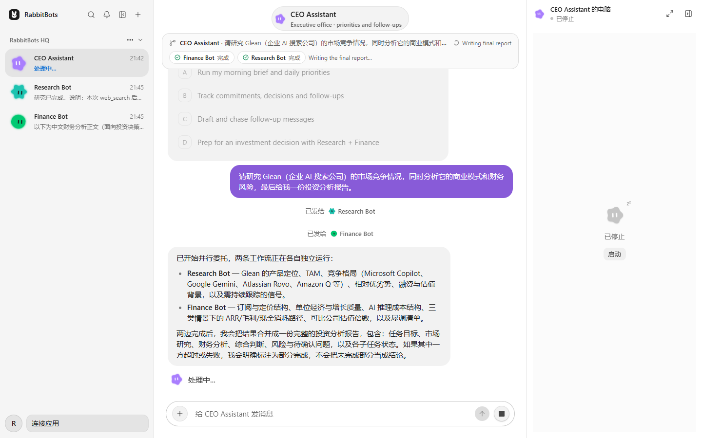
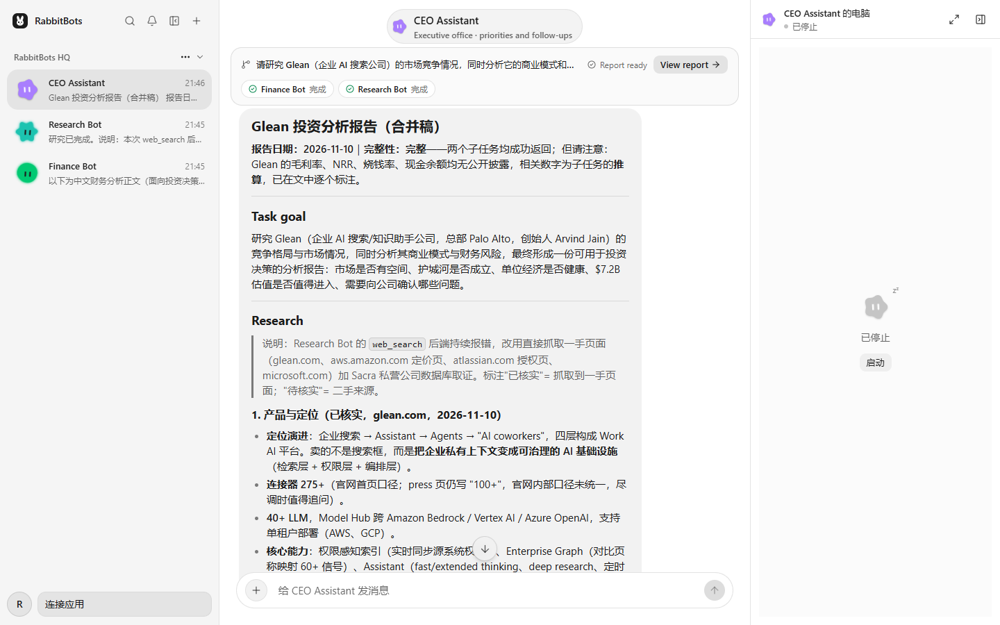
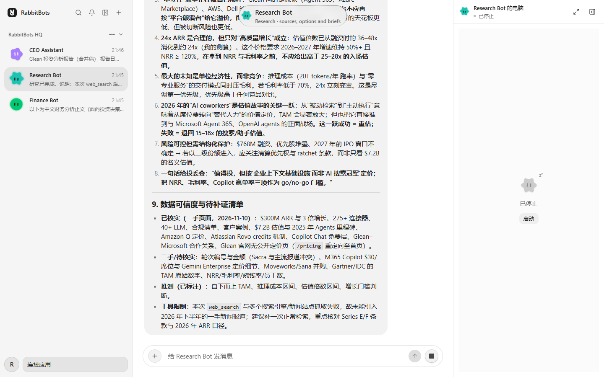
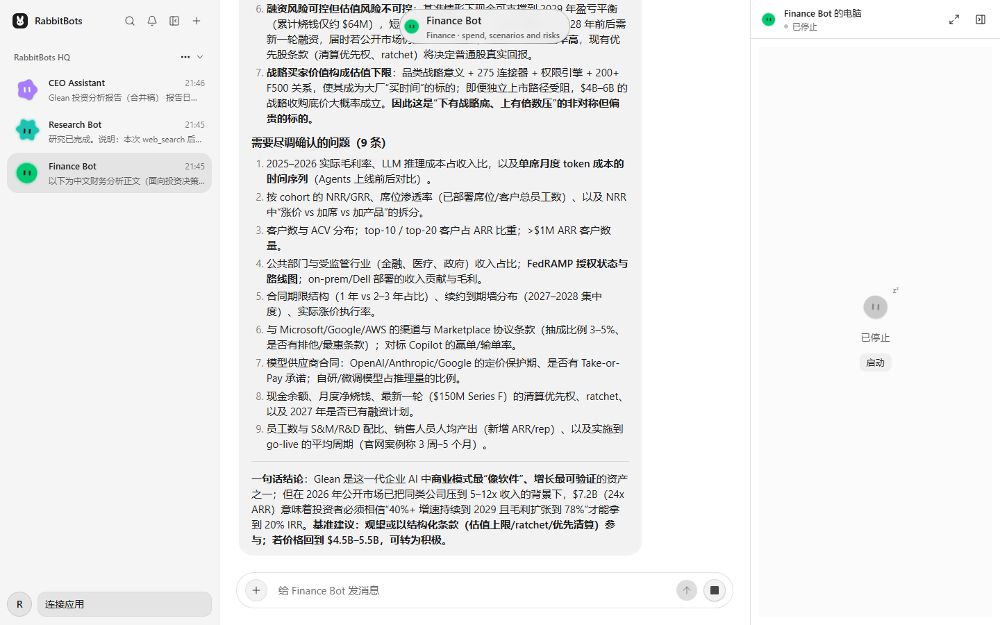
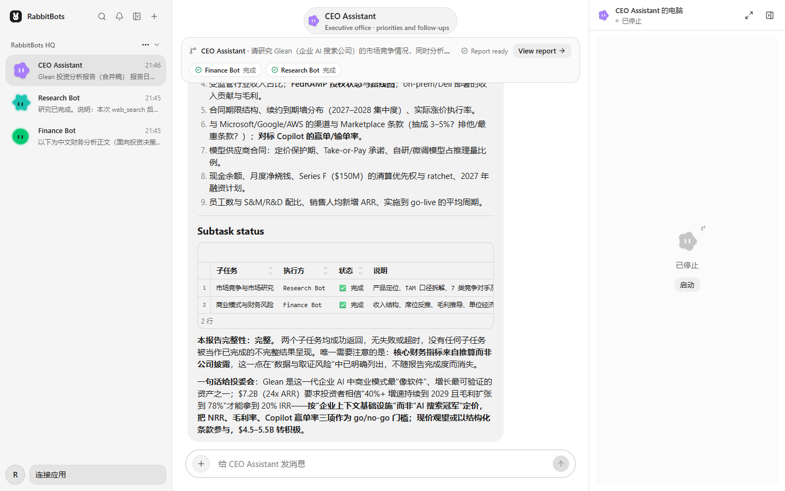
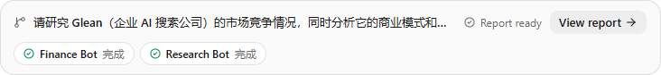
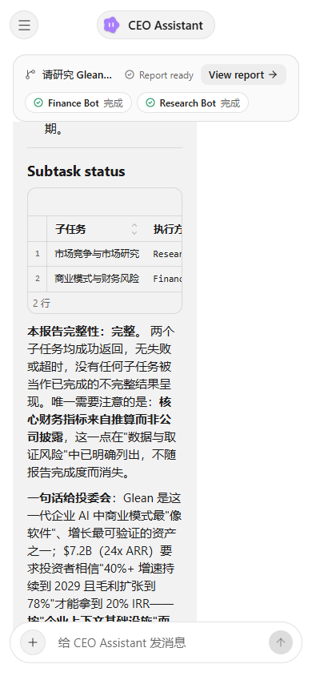
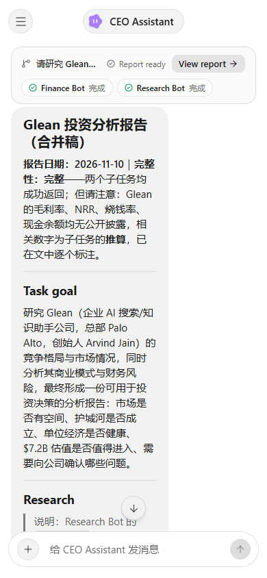

# RabbitBots Phase 1C-1 — Real parallel delegation and joined investment report

Status: implemented and exercised end to end against the local deployment.
Scope: CEO Assistant delegates one request to Research Bot and Finance Bot in parallel, tracks both
children, joins their real persisted results, and writes one final report. Reuses the existing Pi
agent runtime, run worker, bot-message mechanism, database, and three-column workspace.

## What was built

- A new built-in tool, `start_parallel_delegation`, lets the CEO name a goal and two to four child
  tasks, each addressed to an existing bot by id or exact name.
- A new additive pair of tables, `orchestrations` and `orchestration_children`, stores the unique
  orchestration id, the parent run/thread/bot, both child bots, their real task/run/thread ids,
  status, timestamps, errors, and each child's persisted final text plus its message id.
- The tool dispatches the children through the existing `message_bot` path. Each child gets a real
  `Task`, `Run` (`trigger = bot_message`), and inbound message in its own chat, and the child row is
  linked in the same transaction that creates the run.
- Child outcomes are **not** auto-returned as separate CEO wake-ups. The child's final bot message
  remains in its own chat; the orchestration reconciler reads it after the run reaches a terminal
  state.
- A deterministic join creates exactly one CEO run (`trigger = orchestration_join`) after every child
  has settled. Its task prompt contains the original goal, each child's status, its real result (or
  its error/timeout), and instructions to label a partial report plainly. The CEO's normal final
  message becomes the report in the CEO chat.
- The join is idempotent under duplicate completion events, concurrent reconciliation, and worker
  retries: row lock, `running → joining` transition, one unique join-run client nonce, and
  conditional child updates.
- Timeouts are handled at the orchestration deadline. A child whose run never reaches a terminal
  state is marked `timed_out`; the join still runs and the prompt requires it to be reported as
  partial/failed, never as success.
- The existing three-column workspace now shows a persistent, compact orchestration strip above the
  transcript: the CEO's overall status, both real child statuses, and a `View report` entry that
  jumps to the report title. Child chips open the child's own chat. The strip is visible at 1440
  and 390 pixels; no large workspace redesign.

## Actual architecture and call chain

```
user prompt
  -> CEO user run
  -> start_parallel_delegation (tool)
  -> startOrchestration()
       -> orchestrations + orchestration_children (pending)
       -> messageBot() for Research
            -> child Task + Run (bot_message) + inbound message
            -> child row linked (runId/taskId/threadId) in the same tx
       -> messageBot() for Finance
            -> child Task + Run (bot_message) + inbound message
            -> child row linked in the same tx
  -> both child runs execute in parallel in the existing run worker
       -> each child's returnBotMessageOutcome()
            -> sees orchestrationId on the inbound block
            -> skips the normal auto-return
            -> reconcileOrchestration()
  -> reconcileOrchestration()
       -> reads each child run's terminal status and persisted final bot message
       -> child status/result/error completed in the DB
       -> when all settled: createJoinRun()
            -> row lock + unique client nonce
            -> CEO Task + Run (orchestration_join)
            -> join prompt with the real child results
            -> runContinueJob()
  -> normal run worker executes the join run
       -> CEO final report message in the CEO thread
  -> worker periodic reconcileOrchestrations() (30s housekeeping fallback)
       -> catches missed hooks, timeouts, and finalizes joining -> completed
  -> orchestrations.list (API)
       -> derives live child statuses, overall status, outcome, reportMessageId
  -> OrchestrationStrip (web, polls 1.5s active / 5s idle)
```

Key files:

| Layer | File | Role |
| --- | --- | --- |
| Tool schema | `packages/adapters/src/builtin-tools.ts` | `start_parallel_delegation` input schema and description |
| Tool handler | `packages/adapters/src/run-tools-messaging.ts` | Validates context, redacts secrets, calls the start service |
| Start service | `packages/adapters/src/orchestration-start.ts` | Resolves children, creates rows, dispatches `messageBot` |
| Messaging | `packages/adapters/src/bot-messages.ts` | Orchestration linkage, `orchestrationId` blocks, outcome interception |
| Reconciler/join | `packages/adapters/src/orchestration.ts` | Child state, persisted result read, timeout, idempotent join, prompt |
| Worker fallback | `packages/adapters/src/job-reconciler.ts`, `run-runtime.ts` | `reconcileOrchestrations` housekeeping |
| API | `apps/api/src/routes/orchestrations.ts`, `router.ts` | `orchestrations.list` |
| UI | `apps/web/src/pages/shell/orchestration-strip.tsx`, `use-orchestrations.ts`, `Shell.tsx` | Status strip, polling, child links, report jump |
| Visibility | `packages/core/src/message-visibility.ts` | Keeps an orchestration child's report inline instead of folding it as peer chatter |

## Persistence and migration

Two additive migrations:

- `20261211120000_orchestration` adds the `orchestrations` and
  `orchestration_children` tables.
- `20261211130000_orchestration_space_fk` adds a cascading foreign key from
  `orchestrations.spaceId` to `spaces.id`, so deleting a space removes its orchestrations and,
  through the existing child cascade, their children.

The table migration adds:

- `orchestrations`: id, space/user, parent bot/thread/run, optional client nonce, goal, status,
  deadline, join run, joined/completed timestamps, error.
- `orchestration_children`: role, bot, thread/task/run ids, status, result text, result message id,
  error, started/completed timestamps, cascade delete with its orchestration.

No existing table or column is changed. The migrations are additive and safe for the previous
release while it is still running, per the repository migration policy. There is no RLS enablement
on the new tables; every query is explicitly space-scoped (API) or keyed by the orchestration id
created inside the parent run's space (runtime).

## Concurrency, retry, and failure behavior

- **Parallel start**: both children are created and enqueued before the tool returns. The real demo
  showed both `bot_message` runs active at the same time.
- **Tool retry**: the tool uses its effect key as `orchestrations.clientNonce`; a retried call returns
  the existing orchestration and does not dispatch the children twice.
- **Child delivery retry**: `messageBot` keeps its stable delivery key; the child row is linked only
  while `pending`, so a replay cannot create a second child run.
- **Duplicate completion events**: child updates only move out of an unfinished state; the join
  transaction locks the parent row and re-checks. A second reconciler pass reuses the same join run
  or returns without creating one.
- **Worker retry**: the join run is a durable queued run with a unique client nonce; the existing run
  recovery scanner starts it if its job is lost.
- **One child fails**: that child is `failed` with the run error; the join prompt labels the report
  partial and includes the error, and the report must not present it as complete.
- **Both fail**: the join still runs and produces a failure report, not a fabricated result.
- **Timeout**: children that miss the deadline are `timed_out`; the join prompt includes the timeout
  and requires a partial/failed label. The join run itself is not created twice.
- **Join run fails**: the orchestration becomes `failed`; the API derives the failure from the join
  run so the UI does not wait for the next worker pass.
- **No false success**: a child is `completed` only when its persisted run status is `completed`; a
  cancelled or failed run stays failed.

## Real demo evidence

Local demo account, prompt:

> 请研究 Glean（企业 AI 搜索公司）的市场竞争情况，同时分析它的商业模式和财务风险，最后给我一份投资分析报告。

The local dev runner created a branch database, `rakazo_main_0d6e4079`, for the two migrations
(not yet on `origin/main`), copied the local data, and ran this demo there. The demo used a
concrete company (Glean) in the requested prompt shape so the children could use real public pages.

The CEO called `start_parallel_delegation`; the UI showed two real child runs in parallel. Both
children completed and the CEO's joined report was written in the CEO chat.

| Evidence | Value |
| --- | --- |
| Orchestration id | `cmwaqom7s0050xpt6utie7tja` |
| Parent bot | CEO Assistant `cmwaqnjfn4e4lf68on4gae4b7` |
| Research child bot/run | `cmwaqnjgvifljka4yp6olorv6` · completed |
| Finance child bot/run | `cmwaqnji8thl0ifqlxad3ttt8` · completed |
| Join run | `cmwaqtib600cwxpt6p5b3nh46` · `orchestration_join` · completed |
| Final report message | `cmwaqubr200czxpt6kdocyi4m` · 25,447 characters · 273 lines |
| Report sections | Task goal, Research, Finance, Synthesis, Risks and open questions, Subtask status |

The final report states "本报告完整性：完整" and includes a Subtask status table with Research Bot
✅ 完成 and Finance Bot ✅ 完成, plus explicit data limitations: Glean does not publish margin, NRR,
burn, or cash, so those figures are labeled as inferred. The children's `web_search` backend
failed during the run; they switched to direct `web_fetch` of primary pages, and the report says so.
The children needed a few new-site `web_fetch` approvals (including `glean.com`); the demo approved
each once in the child chat, which is the existing site gate, not an orchestration start trigger.

### Screenshots

















The joining and report-bottom screenshots were taken during the same run before the final cosmetic
pass that removed the redundant parent name from the strip; the run, statuses, and reports are the
same.

## Tests

| Command | Result |
| --- | --- |
| `VERIFY_DATABASE=1 DATABASE_URL=… pnpm exec vitest run packages/adapters/src/orchestration.postgres.test.ts` | **10 passed** (7 PostgreSQL + 3 prompt unit tests) |
| `pnpm exec vitest run packages/adapters/src/bot-messages.test.ts packages/adapters/src/run-tools-messaging.test.ts` | **57 passed** |
| `pnpm exec vitest run packages/core/src/message-visibility.test.ts` | **23 passed** |
| `pnpm exec vitest run apps/web/src/pages/shell/orchestration-strip.test.tsx` | **2 passed** |
| `pnpm --filter @rakazo/web test` | **227 files / 2,020 tests passed** |
| Package `check` scripts (contracts, db, core, adapters, api, web) | **passed** |
| `pnpm --filter @rakazo/web build` | **passed** (existing chunk-size warning only) |
| Full adapters suite | **9,352 passed**, 220 skipped, 1 environment failure (`linux-desktop.prepare.test.ts` needs passwordless sudo/apt; unrelated) |

The PostgreSQL test covers: both child tasks/runs created before return and in separate chats;
tool retry returning one orchestration; both successes producing exactly one join and the final
report; one failure producing a partial report with the error; both failures producing a failure
report; deadline timeout; worker retry and duplicate reconciliation; and result isolation between
child chats.

Not run: the Playwright e2e suite cannot run on this Ubuntu 20.04 host (Playwright's Chromium
installer refuses that platform). Browser verification used Windows Chrome with
`playwright-core@1.64.1`; screenshots are from that run.

## Unfinished or environment-limited

- **Local sandbox image unavailable**: the computer image could not be pulled/built in this
  environment. The demo seed therefore disables the full computer/browser tool set for Research and
  Finance, leaving `web_search`/`web_fetch`. Product code still offers the browser/computer tools to
  any bot that has them enabled; this is a demo-data workaround, not a global change.
- **Keyless `web_search` backend is failing in this environment**. The children recovered with
  direct `web_fetch` and the report labels the resulting evidence limits. Fixing the search backend
  is an environment/network task.
- **Delegated `web_fetch` triggers the existing new-site approval** because the request comes from
  another bot, not the owner. The demo approved the requested sites, including `glean.com`, once
  per child. Relaxing that gate for delegated work is a security-policy decision and was not changed.
- **New UI strings are English until translated**. `Delegation running`, `Report ready`,
  `View report`, `Writing final report`, etc. are added in code only; the repository policy is not
  to edit translation catalogs in a feature change.
- The strip's child order for simultaneously-created children is not semantically ordered; both
  statuses are always shown.
- No Git commit or push was made.

## Files changed for Phase 1C

New:

- `packages/contracts/src/orchestration.ts`
- `packages/adapters/src/orchestration.ts`
- `packages/adapters/src/orchestration-start.ts`
- `packages/adapters/src/orchestration.postgres.test.ts`
- `packages/db/prisma/migrations/20261211120000_orchestration/migration.sql`
- `packages/db/prisma/migrations/20261211130000_orchestration_space_fk/migration.sql`
- `apps/api/src/routes/orchestrations.ts`
- `apps/web/src/pages/shell/use-orchestrations.ts`
- `apps/web/src/pages/shell/orchestration-strip.tsx`
- `apps/web/src/pages/shell/orchestration-strip.test.tsx`
- `docs/reports/RABBITSBOTS-PHASE-1C-1-ORCHESTRATION.md`
- `docs/reports/assets/phase1c-*.png`

Modified:

- `packages/db/prisma/schema.prisma`
- `packages/contracts/src/{runs,events,builtin-tools,rpc,index}.ts`
- `packages/adapters/src/{bot-messages,builtin-tools,run-tools-messaging,run-tool-selection,job-reconciler,run-runtime,index}.ts`
- `packages/adapters/src/builtin-tool-bridge.test.ts` (tool-catalog byte budget for the new deferred tool)
- `packages/core/src/message-visibility.ts` and `message-visibility.test.ts`
- `apps/api/src/router.ts`
- `apps/web/src/pages/Shell.tsx`
- `scripts/rabbitbots-demo-seed.mjs`

Prior Phase 1B work (branding, three-column workspace, Computer Workspace, screenshots) remains in
the working tree and was not reverted.

## Git status

`git status --short` reports 104 paths: 85 modified and 19 untracked. This is cumulative with the
prior Phase 1B work; the Phase 1C files are listed above. Nothing was committed or pushed. `.env`
was not modified. `scripts/dev.mjs` still carries the Phase 1B PostgreSQL port change
(`54318 → 55450`).

Known test-suite note: the PostgreSQL orchestration tests are gated by `VERIFY_DATABASE=1` (the
repository's existing pattern); the default adapter suite skips them and the command above runs
them explicitly.
