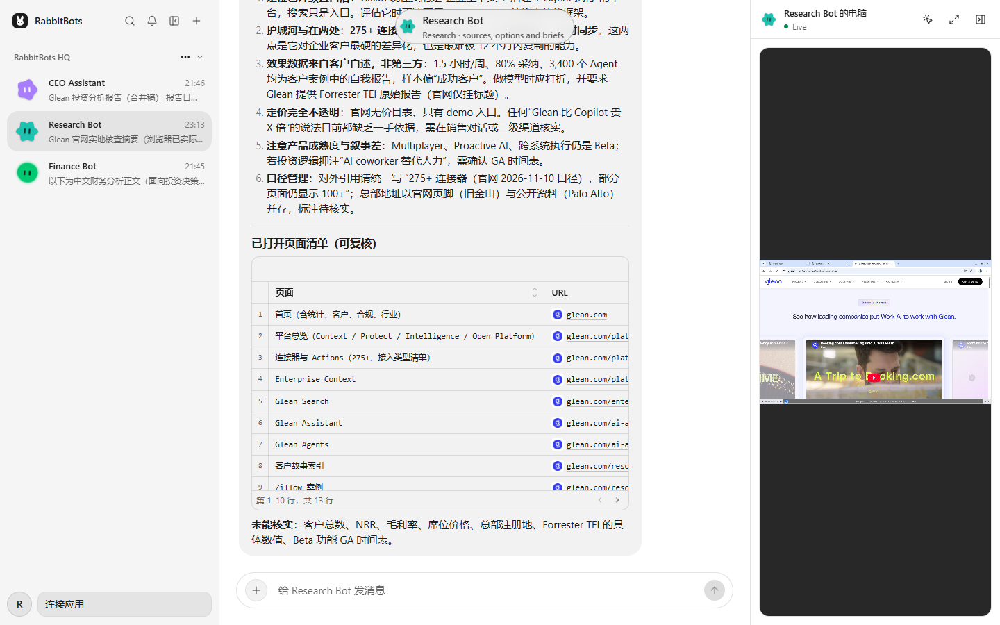
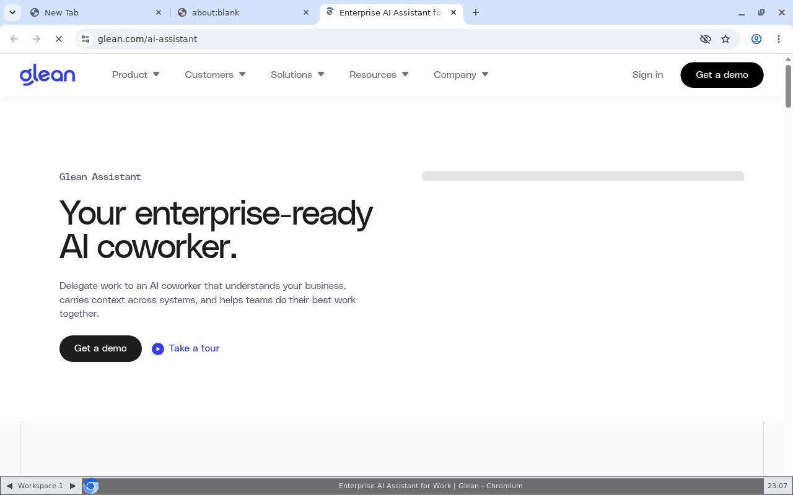
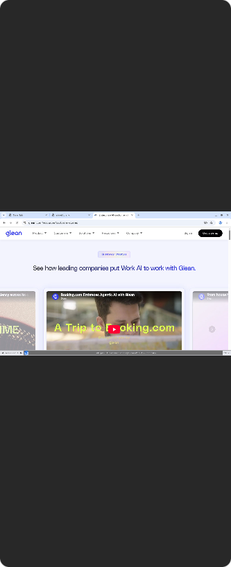
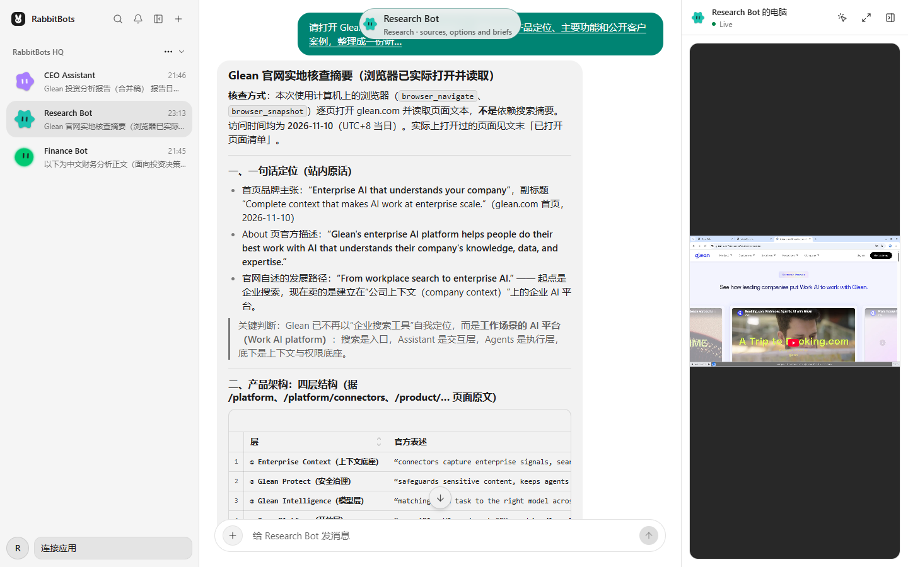

# RabbitBots Phase 1D-1 — Real Computer Runtime and vision check

Status: the real Docker Linux desktop, browser, noVNC screen, and Research Bot browser task are
working end to end. A separate computer-use vision model is **BLOCKED** because no second
vision-capable provider connection or key is configured; the deployed main model's image input was
verified directly, and the browser task did not depend on screenshot reasoning.

## 1. Computer Runtime recovery

Docker Desktop 4.98.0, engine 29.9.2, Linux containers, `/var/lib/docker` on Docker Desktop. The
repository's `infra/sandboxes/computer` implementation was used unchanged.

### What blocked the stock build

- The Dockerfile pins `debian:bookworm-slim@sha256:3783…`. `docker manifest inspect` for that digest
  timed out against Docker Hub, and `docker pull` returned success without adding an image.
- A normal build then failed at `COPY apt-security.sh` with `DeadlineExceeded`, and apt downloads
  from `deb.debian.org` ran at roughly 2–4 KB/s. This is a confirmed registry/network blocker, not
  a Dockerfile version problem.
- Docker Desktop's own build proxy was also slow for Debian. A local HTTP proxy on the Windows host
  (port 3139) plus the current locally cached `debian:bookworm-slim` tag and the TUNA Debian mirror
  made the package install fast.
- GitHub and `releases.astral.sh` were inaccessible from both the host and the build network, so the
  local image build skipped the optional `uv`/`gh` downloads. The browser stack does not need them.
  `agent-browser` 0.41.0 was taken from the npm `agent-browser@0.41.0` tarball; its
  `agent-browser-linux-x64` binary hash matches the image installer's pinned
  `399c7e9f…` hash.
- The build used a **temporary Dockerfile outside the repository** to substitute the mirror and the
  local agent-browser binary. **`infra/sandboxes/computer/Dockerfile` is unchanged**; the base
  **version** is still Debian bookworm-slim. This is a local-network workaround, not a product
  Dockerfile change.

### Image result

```
image:  rakazo/computer:local
id:     sha256:16c47293590c91f0fa1e18c09f3f013ac4071b3be5653bb060f7c22a642dc20c
size:   2.21 GB
```

Smoke test inside the image:

- Chromium `156.0.8078.79`
- agent-browser `0.41.0`
- `Xvfb`, `x11vnc`, `websockify`, `noVNC` present
- the browser/desktop/noVNC entrypoints and `rakazo-computer` start script are present

The only expected difference from a stock image is the absence of the optional `uv`/`gh` developer
CLIs, which the build network could not fetch. The tracked Dockerfile still downloads them when the
network allows.

## 2. Real computer boot and visible states

Research Bot's dedicated Docker computer:

| Item | Value |
| --- | --- |
| Bot | Research Bot `cmwaqnjgvifljka4yp6olorv6` |
| Computer row | `cmwaqnjh2003mxpt6nhqo4g2s`, `docker`, `dedicated` |
| Container | `rakazo-bot-cmwaqnjgvifljka4yp6olorv6` |
| Image | `rakazo/computer:local` |
| State during the demo | `running` |
| Screen | 1280×800 noVNC, proxied through `/novnc/session/view/…` |

Starting from the workspace produced a real boot: the header showed `Stopped`, then `Starting…` with
a real gray boot screen, then `Live`. The container was independently confirmed with `docker ps`
(`Up`). The Railway-style fake providers were not used.

All four UI states were observed from real runtime state:

- **Stopped**: `phase1d-computer-stopped-1440.png`
- **Booting**: `phase1d-computer-booting-1440.png`
- **Running**: `phase1d-workspace-live-1440.png` and `phase1d-screen-glean-1280.png`
- **Error**: `phase1d-computer-error-1440.png` — a real prior boot error on the demo2 Research
  computer, showing the actual `电脑启动失败 / 重新连接屏幕` (boot failed / reconnect screen) UI.

### Workspace screen fix

Opening the workspace on an **already-running** computer previously left the panel on its placeholder
because the screen URL was only loaded when booting or opening the legacy computer panel. Phase 1D
adds a dedicated workspace screen load in
`apps/web/src/pages/shell/use-computer.tsx`, outside the stale-request token so the one-time noVNC
capability commits, plus a regression test in `use-computer.test.tsx`.

Screenshots:







## 3. Research Bot real browser task

Prompt sent to Research Bot's own chat:

> 请打开 Glean 官网（https://www.glean.com/），查找它的产品定位、主要功能和公开客户案例，整理成一份研究摘要。必须实际使用浏览器工具打开并读取真实页面，不要只依赖搜索摘要。

Result:

| Evidence | Value |
| --- | --- |
| Research run | `cmwatr70y000cb3t6d4hxw2g3` · completed at 2026-11-10 23:13:18 UTC+8 |
| Completed browser tool calls | 23 × `browser_navigate`, 10 × `browser_snapshot`, 5 × `browser_act` |
| Final answer | `cmwatxxna003hb3t6yvg7gnoe` · 6,718 characters |
| Final answer title | `Glean 官网实地核查摘要（浏览器已实际打开并读取）` |
| Opened-page list | 13 pages in the report's table, including `glean.com`, `/platform`, `/platform/connectors`, `/ai-assistant`, `/agents`, `/resources` and customer stories |

The answer explicitly says the browser tools opened the pages and read page text, rather than relying
on search snippets. It lists the pages it opened and what it could not verify. The report is saved in
Research Bot's own chat; the screenshot above shows it alongside the live browser.

Chat isolation: only Research Bot ran a new turn. A database count since 23:00 gives **CEO 0,
Finance 0, Research 1** model runs; no CEO or Finance message was created or changed. The Finance
computer was started separately for the lifecycle screenshot and then stopped; no Finance chat
message resulted.



## 4. Vision model status

### What was verified

The deployed main model is `deepseek/deepseek-flash` (DeepSeek V4.1 Flash). The model catalog marks it
`images: true`, and the API's main role reports `seesImages: true`.

A direct image request to the provider was used to test the claim rather than assume it:

- The request sent the 1280×800 Glean screenshot as a base64 `image_url`, model `deepseek-flash`.
- First probe: HTTP 200, `model: deepseek-flash`, and the response reasoned about the browser tabs
  in the screenshot (it hit the token limit while reasoning).
- Second probe, with 800 output tokens: HTTP 200, `finish_reason: stop`, and
  `content: "The Glean AI Assistant page at glean.com/ai-assistant is open."`

So **DeepSeek Flash itself is actually vision-capable here**. The app's `seesImages: true` is not a
false claim, and the app would offer screenshot computer tools to the main model. This does not
satisfy the stricter requirement of a **separate configured vision model**, and it is not what the
Research browser task used.

### Separate computer-use model: BLOCKED

- `models/role` for `computer`: `primary: null`, `backups: []`, `deploymentPrimary: null`.
- The account has **no connected model credentials** (`models/credentials` → `[]`).
- Only `DEEPSEEK_API_KEY` is configured in the environment; there is no OpenRouter, OpenAI,
  Anthropic, Google or other provider key.
- Ollama is running on the host but has **zero models**, so it cannot serve a local vision fallback.
- The computer-use role requires a member-owned connection and is skipped when it names the main
  model. Setting it to the same DeepSeek Flash would therefore not create an independent vision
  model.

**BLOCKED: no independent computer-use vision model is configured or callable.** The main
DeepSeek's image input is verified, but it is not the requested separate role. No API key was written
to the repository, logs, screenshots or report; the probe read the key from the environment and
printed only the response.

### How to configure a separate vision model

Keep the text deployment unchanged:

```dotenv
PI_DEFAULT_PROVIDER=deepseek
PI_DEFAULT_MODEL=deepseek-flash
DEEPSEEK_API_KEY=…
```

Then, without changing the main text model:

1. Connect a vision-capable provider under **Settings → Models** (or `models/connect`). A cloud
   provider needs its own key; an OpenAI-compatible endpoint uses its base URL, protocol and
   `supportsImages`.
2. For a compatible endpoint, declare which model ids accept images, for example
   `RAKAZO_OPENAI_COMPATIBLE_VISION_MODELS=llava,moondream`, and allow the private endpoint if it is
   localhost.
3. Choose **Computer-use model** (the `computer` role) in settings, or call
   `models/setRole` with `{ role: "computer", primary: { provider, modelId, credentialId } }`.
4. Do **not** change `PI_DEFAULT_PROVIDER` to the vision provider unless the main text model should
   change. The role is account/space-scoped and uses the member's connection, not the deployment key.
5. The computer role is skipped if the main model itself can see; a separate role only takes effect
   when the main model cannot see the screen.

## 5. Tests and build

| Check | Result |
| --- | --- |
| `pnpm --filter @rakazo/web test` | **227 files / 2,021 tests passed** |
| `pnpm --filter @rakazo/web check` | **passed** |
| `pnpm --filter @rakazo/web build` | **passed** (existing chunk-size warning) |
| `use-computer.test.tsx` | **17 passed**, including the new already-running workspace screen test |
| Docker image smoke test | Chromium, agent-browser, Xvfb, x11vnc, websockify and noVNC all present |
| Real runtime | Docker container `Up`, workspace `Live`, noVNC screen served |
| Real browser task | 23 navigations, 10 snapshots, 5 acts, completed answer |

Not run: the Playwright e2e suite cannot run on this Ubuntu 20.04 host; browser verification used
Windows Chrome with `playwright-core@1.64.1`.

## 6. Files changed for Phase 1D-1

New:

- `docs/reports/RABBITSBOTS-PHASE-1D-1-COMPUTER-VISION.md`
- `docs/reports/assets/phase1d-computer-stopped-1440.png`
- `docs/reports/assets/phase1d-computer-booting-1440.png`
- `docs/reports/assets/phase1d-computer-error-1440.png`
- `docs/reports/assets/phase1d-workspace-live-1440.png`
- `docs/reports/assets/phase1d-screen-glean-1280.png`
- `docs/reports/assets/phase1d-research-report-1440.png`
- `docs/reports/assets/phase1d-workspace-screen-333.png`
- `docs/reports/assets/phase1d-finance-running-1440.png`

Modified:

- `apps/web/src/pages/shell/use-computer.tsx` — load a screen when the workspace opens on an
  already-running computer; the screen URL bypasses the stale-request token for this single view.
- `apps/web/src/pages/shell/use-computer.test.tsx` — regression test for that path.
- `scripts/rabbitbots-demo-seed.mjs` — Research Bot now keeps its browser tools enabled and its
  preset instructions tell it to use `browser_navigate`/`browser_snapshot`/`browser_act`. Finance
  keeps the browser tools disabled for its separate role.

Not modified:

- `infra/sandboxes/computer/Dockerfile` and all computer runtime source files.
- The Phase 1C join/orchestration code.
- `.env` (no new keys; existing values untouched).

The local image and the temporary Docker build files live outside the repository, not in Git.

## 7. Git status

Final `git status --short`: **105 paths** — 86 modified and 19 untracked, cumulative with Phase 1B
and 1C. No commit or push was made. `.env` was not modified. The Phase 1B PostgreSQL port change
(`54318 → 55450`) is still present in `scripts/dev.mjs`. The Docker image, temp Dockerfiles,
proxy and probe scripts are outside the repo or uncommitted.

The running dev stack uses branch database `rakazo_main_0d6e4079`. The Research computer is left
running with the Glean browser open; the Finance computer was stopped after the lifecycle screenshot.

## 8. Remaining limitations

- The local image omits optional `uv`/`gh` because GitHub/astral were unreachable. A network-enabled
  rebuild should restore them; the browser/desktop/noVNC runtime is complete.
- The stock base digest could not be fetched; the local build used the same Debian bookworm-slim tag
  instead. The tracked Dockerfile still pins the original digest.
- **Separate computer-use vision model is BLOCKED** as described above; the main DeepSeek's vision
  was verified directly but was not used for the task.
- `web_search` still fails in this environment; the browser task did not depend on it.
- The workspace screen is letterboxed (1280×800 in a narrow rail); it is live and readable, and the
  full-screen capture shows the browser clearly. Opening the screen in a phone-width rail leaves
  black bars above and below the 16:10 desktop.
- The Error screenshot is a real prior boot error, not a freshly induced failure; no live failure was
  forced after the image was built.
- Playwright e2e remains unavailable on Ubuntu 20.04; the browser evidence was captured with
  headless Windows Chrome.
