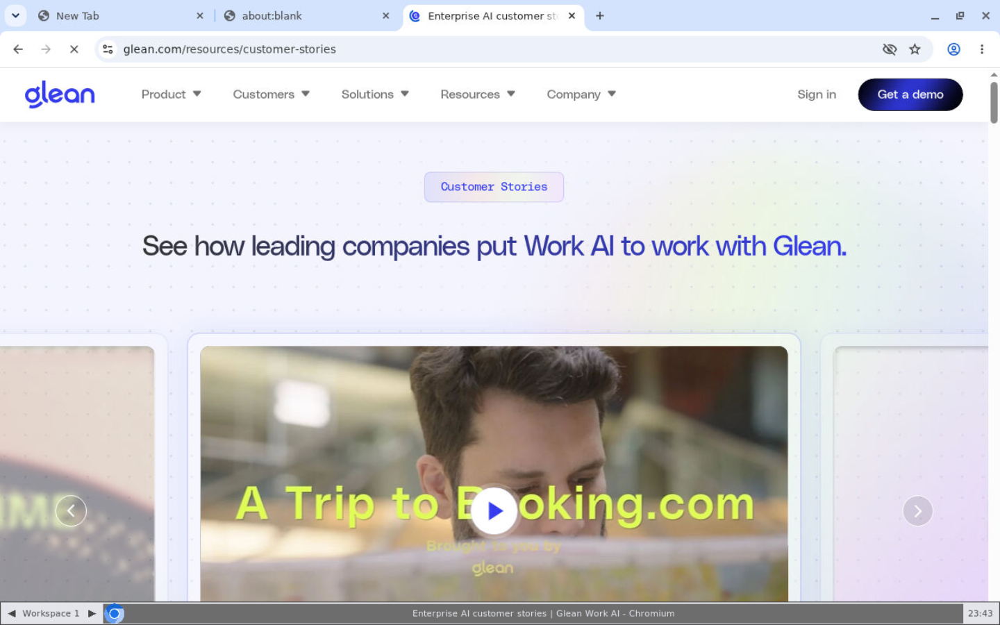
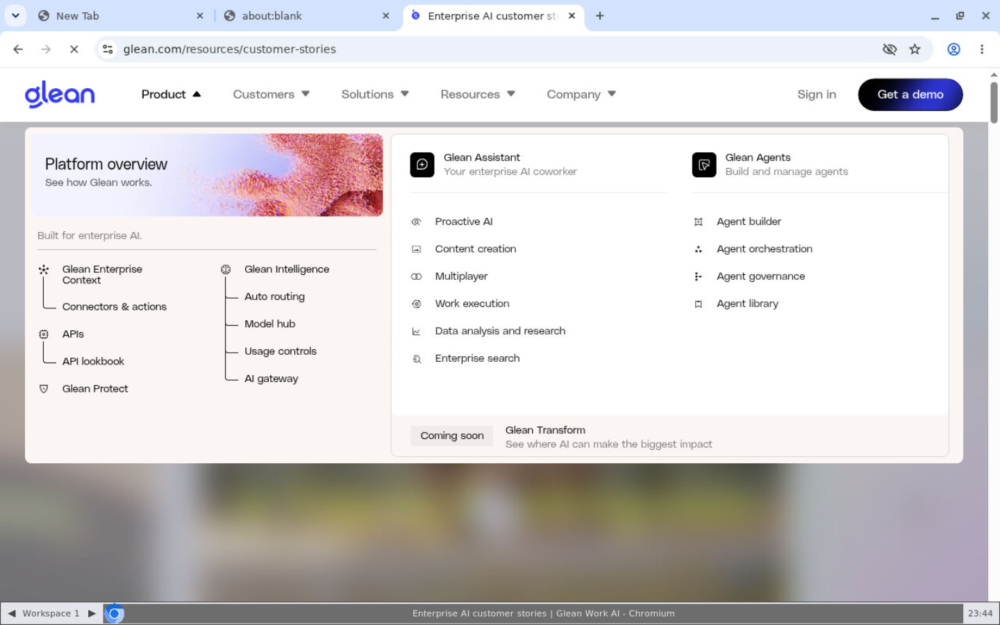
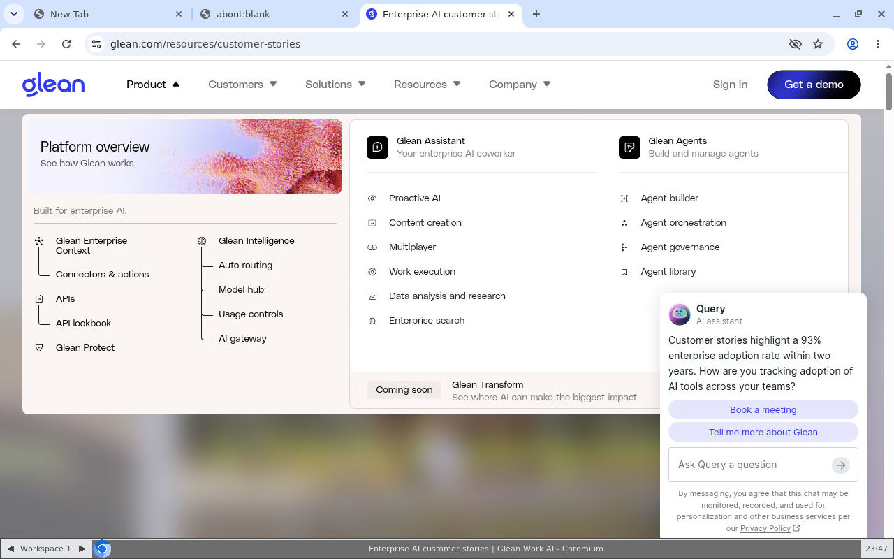
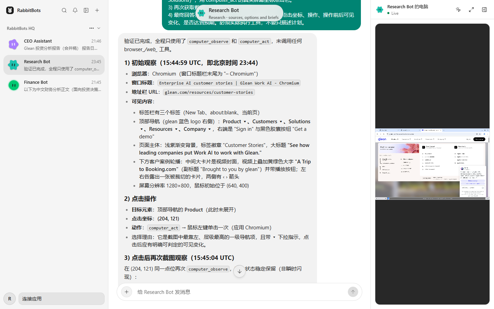
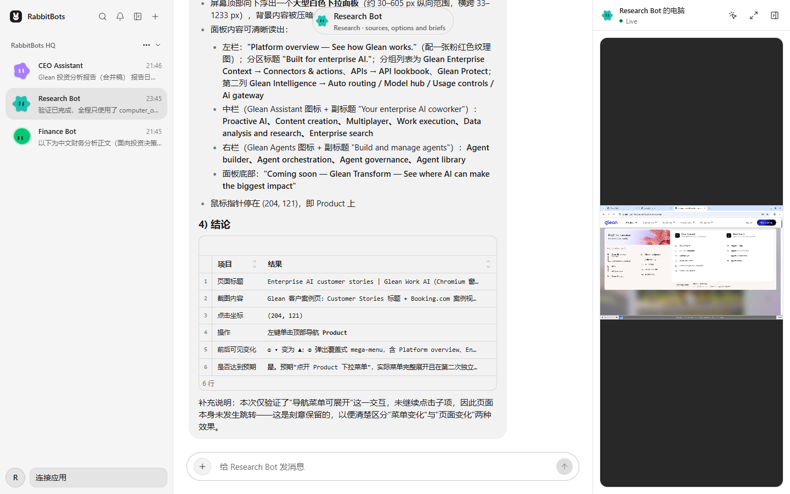

# RabbitBots Phase 1D-2 — Visual Computer Use Validation

Status: **PASS**. Research Bot used only `computer_observe` and `computer_act` to receive real
1280×800 desktop screenshots, identify the visible Chromium page, choose a navigation element from
the image, click it at image-derived coordinates, observe the changed screen, and record the result
in its own chat. No browser or DOM tool was used in the validated run.

There is no separate computer-use vision provider in this phase, by design. The deployed main model
`deepseek/deepseek-flash` is the image-capable model; its image input was already verified in Phase
1D-1 and the runtime tool results here carry real image content.

## 1. Preflight

| Check | Value |
| --- | --- |
| Branch | `main` |
| HEAD | `6c7e1bcc6` |
| Working tree | 105 paths: 86 modified + 19 untracked (cumulative with 1B/1C/1D-1) |
| Web / API / supervisor | `127.0.0.1:5173`, `:3100`, `:7091` |
| PostgreSQL branch DB | `rakazo_main_0d6e4079` |
| Research computer | Initially `suspended`; woken to `running` |
| Computer container | `rakazo-bot-cmwaqnjgvifljka4yp6olorv6` on `rakazo/computer:local` |
| Main model | `deepseek/deepseek-flash`, `seesImages: true` |
| Computer role | `primary: null`, `deploymentPrimary: null` (no second provider) |

Before the run, Research Bot was temporarily configured for visual-only operation:

- `computer_observe` and `computer_act` enabled;
- `browser_navigate`, `browser_snapshot`, `browser_act`, `web_search`, `web_fetch`, shell and file
  tools disabled;
- instructions told it to use only the Computer screen tools and to put the visual evidence in its
  final answer.

After the validation, Research Bot was restored to its Phase 1D-1 product configuration (browser
tools enabled, `computer_observe`/`computer_act` disabled). This was bot settings data, not a code
change. The seed script already carries the restored browser-enabled preset.

## 2. Actual run

| Item | Value |
| --- | --- |
| Research run | `cmwav2mz1004db3t669fq98t5` |
| Started | 2026-11-10 23:44:57 UTC+8 (prompt sent) |
| Tool calls | `computer_observe` at 23:44:59, `computer_act` at 23:45:01, `computer_observe` at 23:45:04 |
| Completed | 23:45:11 UTC+8 |
| Final answer | `cmwav2xga004nb3t6b2yvz5wy`, 3,897-byte text / 47 lines |
| Tool result images | 3 successful results with `contentTypes: ["text", "image"]` |
| Browser/DOM tools | **0** in this run |
| Web tools | **0** in this run |
| Screen size | 1280×800 |

Event evidence:

- `computer_observe` #1: `outcome: succeeded`, `width: 1280`, `height: 800`,
  `contentTypes: ["text", "image"]`, `capturedAt: 2026-11-10T15:44:59.211Z`;
- `computer_act`: `outcome: succeeded`, `width: 1280`, `height: 800`,
  `contentTypes: ["text", "image"]`, `capturedAt: 2026-11-10T15:45:01.837Z`;
- `computer_observe` #2: `outcome: succeeded`, `width: 1280`, `height: 800`,
  `contentTypes: ["text", "image"]`, `capturedAt: 2026-11-10T15:45:04.359Z`.

The tool results being typed with image content is the runtime-side proof that the model received
the screenshots. The model's answer then describes pixel-level content that is only in the image:

- window title `Enterprise AI customer stories | Glean Work AI - Chromium`;
- URL `glean.com/resources/customer-stories`;
- top navigation `Product ▾, Customers ▾, Solutions ▾, Resources ▾, Company ▾`, `Sign in`,
  `Get a demo`;
- the `Customer Stories` badge, the headline “See how leading companies put Work AI to work with
  Glean.”, the Booking.com video card, and the left/right carousel arrows;
- “屏幕分辨率 1280×800，鼠标初始位于 (640, 400)”;
- after the click: the mega-menu spans roughly x=33–1233, y=30–605, with Platform overview,
  Enterprise Context/Connectors, APIs/API lookbook, Glean Protect, Glean Intelligence, Assistant
  and Agents columns, and “Coming soon — Glean Transform”.

## 3. Visual decision and operation

The recorded steps message states:

> Observed: Chromium browser, page title "Enterprise AI customer stories | Glean Work AI –
> Chromium", URL `glean.com/resources/customer-stories`. The top nav shows Product, Customers,
> Solutions, Resources, Company, plus Sign in and "Get a demo". I'll click the visible **Product**
> nav item at (204, 121).

Operation:

- target: visible top navigation **Product**;
- coordinates: **(204, 121)**;
- action: `computer_act` left click once, application Chromium;
- rationale: leftmost, highest-level navigation with a `▾` affordance; a visible change is expected.

Before: `Product ▾`, no panel, customer-stories page.

After the click, a second independent `computer_observe` at the same point showed:

- `Product` now ends in `▲`;
- a large white mega-menu covers the content, with the sections above;
- the page behind is dimmed/blurred;
- URL and window title remain `glean.com/resources/customer-stories` and
  `Enterprise AI customer stories | Glean Work AI - Chromium`;
- the menu is still present in a later 1280×800 capture, so this is not a transient hover.

Exact 1280×800 confirmation (the size the model actually received):

The screenshot also shows Glean's own “Query” assistant popup that appeared after the click; it is
part of the real page, not a RabbitBots overlay.

## 4. PASS / BLOCKED / NOT TESTED

### PASS

- [x] DeepSeek Flash received real desktop screenshots: three tool results with image content.
- [x] The model correctly identified the browser, page title, URL and visible content from the image.
- [x] The model based its action on the image: it chose Product and supplied (204, 121).
- [x] `computer_act` executed a real click on the real Chromium desktop.
- [x] The after screenshot shows a visible state change: `Product ▾` → `Product ▲` and a large
      mega-menu; a later capture confirms it is stable.
- [x] Research Bot's own Chat contains the complete observation, click coordinates, before/after
      change and expected-result table.
- [x] CEO and Finance were not touched: since 23:40 their new-run counts are 0 and 0; Research is 1.
- [x] No browser/DOM or web tool was called in the validated run (0/0).

### NOT TESTED

- **URL/page-body navigation after opening the menu.** The validated operation deliberately opened
  a navigation mega-menu; the model explicitly notes that it did not click a sub-item, so the URL
  stayed on the customer-stories page. This is a visible page-state change, not a URL navigation.
  A second run could click a menu link if a strict URL change is required.
- **Separate computer-use vision provider/role.** Out of scope for 1D-2; no second provider key is
  configured and the main DeepSeek model already receives images.
- Playwright e2e on Ubuntu 20.04 remains unavailable; evidence was captured with headless Windows
  Chrome.

### BLOCKED

- None for visual Computer Use itself. The runtime registered the screenshot tools, the model
  received images, and the click executed.

## 5. Research Bot chat

The final answer is visible in Research Bot's own chat and is also captured with the live workspace
menu on the right.

The bottom of the answer contains the result table (page, screenshot contents, click coordinates,
action, before/after change, expected result), and the workspace screen shows the same menu.

## 6. Tests and build

| Check | Result |
| --- | --- |
| `pnpm --filter @rakazo/web check` | **passed** |
| `pnpm exec vitest run apps/web/src/pages/shell/use-computer.test.tsx` | **17 passed** |
| `pnpm --filter @rakazo/web build` | **passed** (existing chunk-size warning) |
| Full web suite from the prerequisite 1D-1 code | **227 files / 2,021 tests passed** |
| Visual run | **2 observes / 1 act / 0 browser or web tools / 3 image results** |

No product code was changed in 1D-2. The prerequisite 1D-1 workspace-screen fix and its regression
test remain in place.

## 7. Files and Git status

New for this phase:

- `docs/reports/RABBITSBOTS-PHASE-1D-2-VISUAL-COMPUTER-USE.md`
- `docs/reports/assets/phase1d2-screen-before-1440.png`
- `docs/reports/assets/phase1d2-screen-after-1440.png`
- `docs/reports/assets/phase1d2-screen-after-1280.png`
- `docs/reports/assets/phase1d2-chat-final-1440.png`
- `docs/reports/assets/phase1d2-chat-final-bottom-1440.png`
- `docs/reports/assets/phase1d2-workspace-before-1440.png`

No code or runtime files changed. The temporary visual-only bot configuration was restored to the
Phase 1D-1 browser-enabled preset after the run.

`git status --short`: **105 paths** — 86 modified and 19 untracked, cumulative with 1B/1C/1D-1.
No commit or push was made. `.env` was not modified; no API key, cookie or token was printed or
stored in the report.

## 8. Remaining issues

- The validated action opened a mega-menu, not a new URL. The model documented this distinction
  itself. A follow-up visual click on a menu link would be the next validation if URL navigation is
  required.
- Glean's own Query popup appeared during the after screenshot; it is unrelated to the agent.
- The before/after full-screen viewer screenshots are 1440×900, while the model's actual screen is
  1280×800; the exact 1280×800 after capture is included.
- The temporary visual-only bot configuration was required to force the visual path; the restored
  product configuration uses browser DOM tools for ordinary research.
