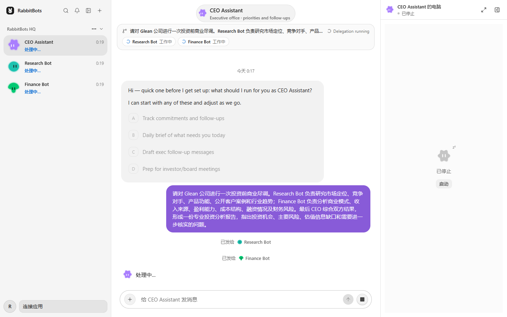
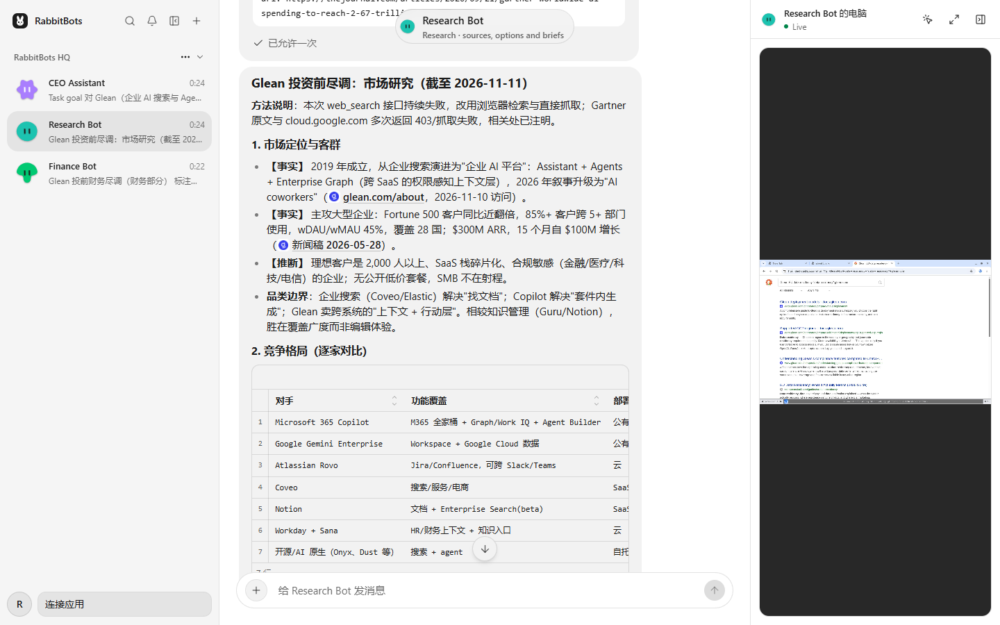
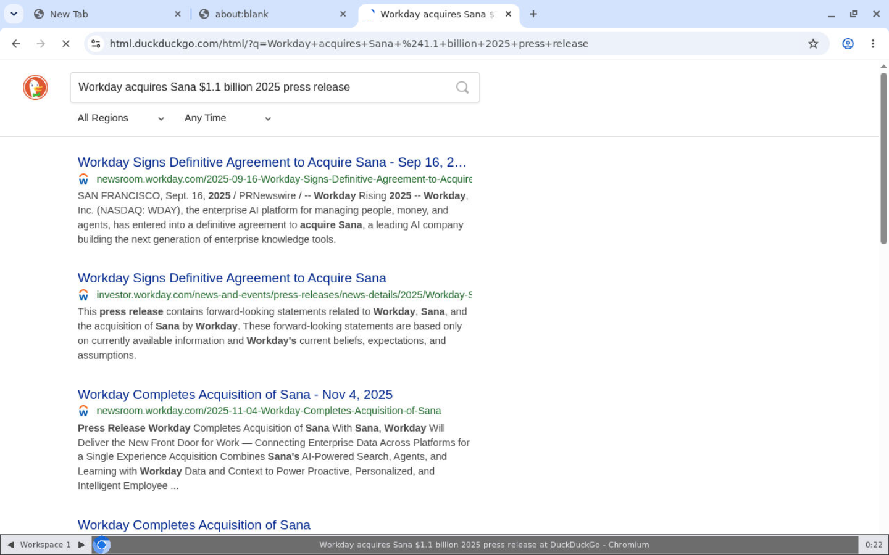
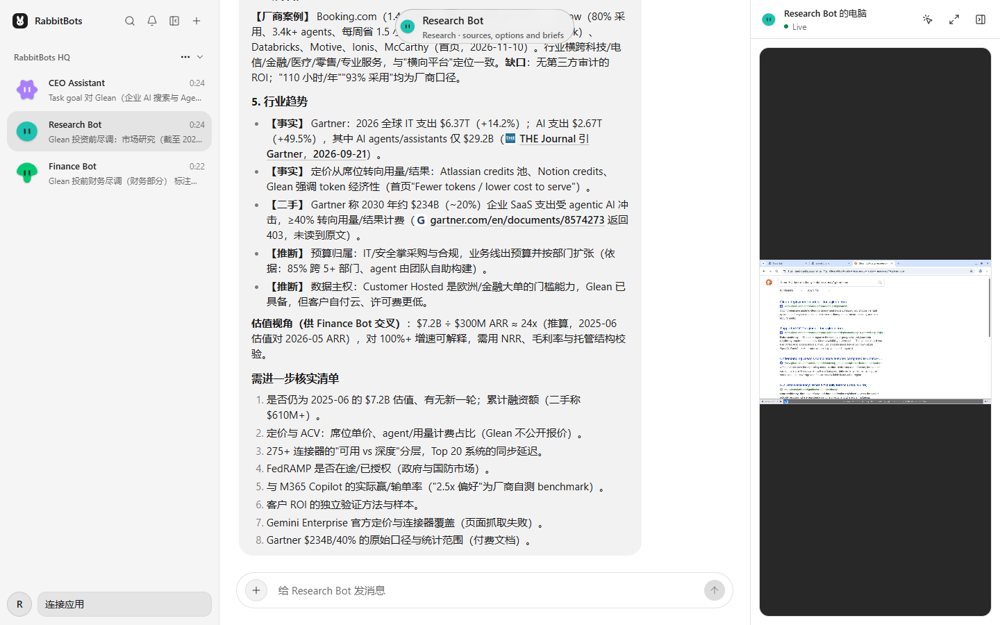
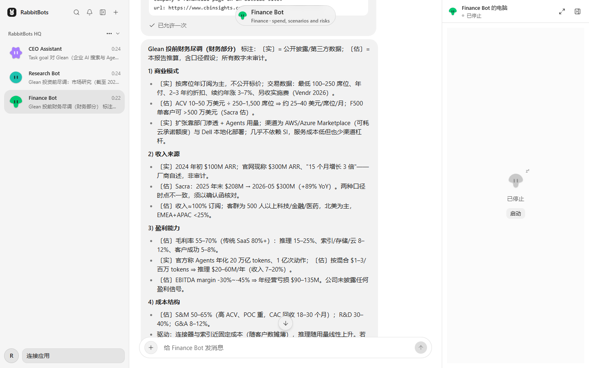
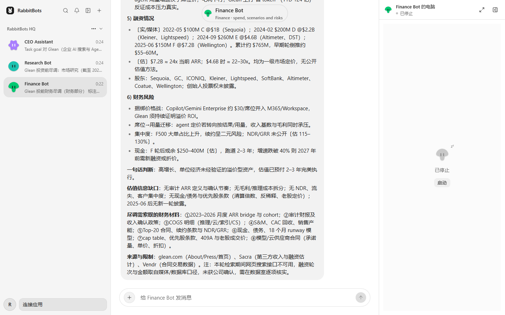
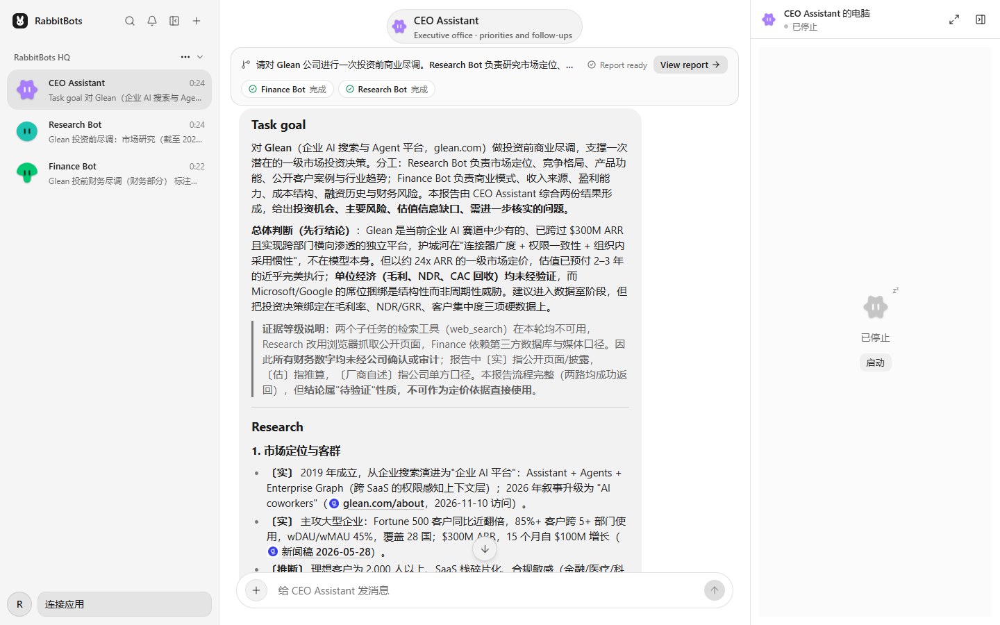
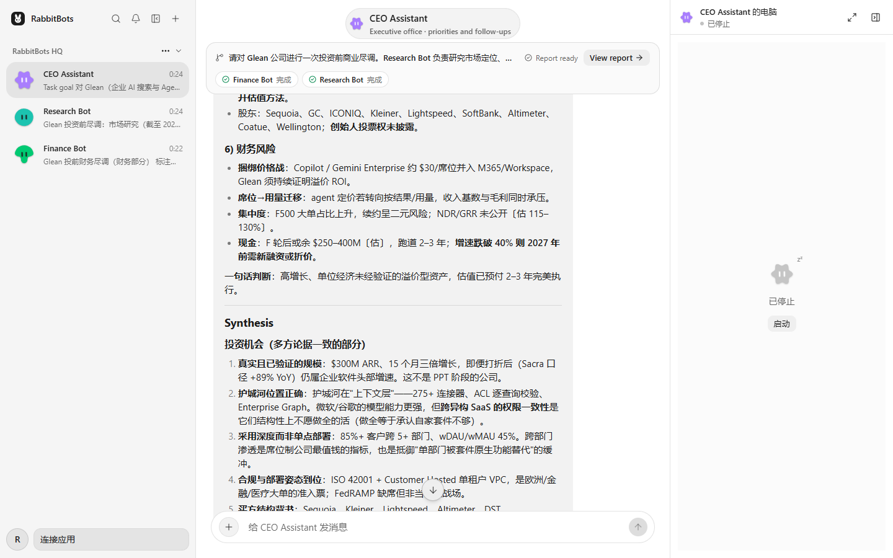
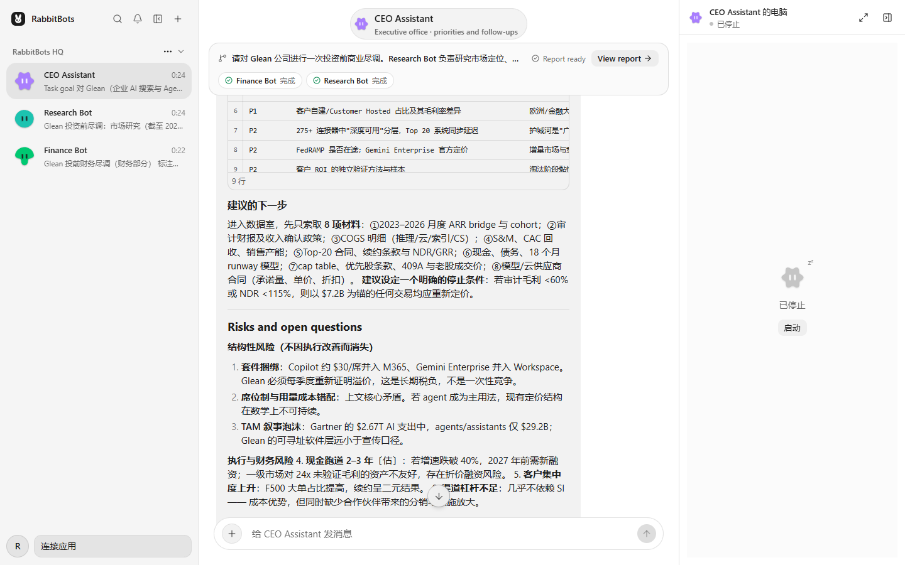
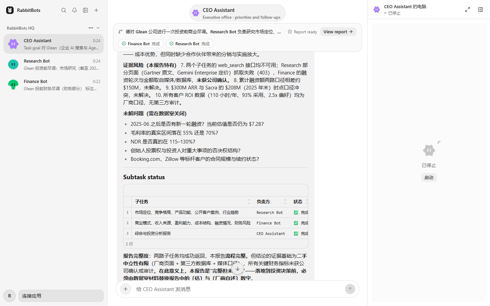

# RabbitBots Phase 1E — Investor Demo, End to End

Status: **PASS**. A fresh demo account received the investment due-diligence prompt through CEO
Assistant. CEO Assistant launched Research Bot and Finance Bot through the existing Phase 1C
`start_parallel_delegation` path; both ran simultaneously in their own tasks, runs, and threads;
each delivered a report in its own chat. The single Join run then read both real results and wrote
the CEO investment report into the CEO chat.

No orchestration code was rewritten, no simulation was substituted for a child run, and the demo
does not depend on a second vision provider.

## 1. Preflight

| Check | Value |
| --- | --- |
| Repository | `/home/root1/workspaces/RabbitBots` |
| Branch / HEAD | `main` / `6c7e1bcc6` |
| Working tree | 105 paths: 86 modified + 19 untracked (cumulative with 1B/1C/1D) |
| Web / API / Supervisor | `127.0.0.1:5173`, `:3100`, `:7091` all listening |
| PostgreSQL | `rakazo-dev-postgres`, branch database `rakazo_main_0d6e4079` |
| Demo account | fresh `rabbitbots.demo4@example.com` with its own space |
| CEO tools | full; `start_parallel_delegation` not disabled |
| Research tools | browser tools enabled; `computer_observe`/`computer_act` disabled for normal research |
| Finance tools | browser tools disabled; `web_search`/`web_fetch` enabled; messaging/ask/delegation disabled |
| Research Computer | started from `stopped` to `running`; real Chromium desktop displayed |
| CEO / Finance Computer | stopped (not used for this workflow) |

The fresh account's three bots, three threads, and three dedicated Computer records were created
before the task. There was no cross-thread history from earlier demos.

## 2. The task

The exact prompt sent to CEO Assistant:

> 请对 Glean 公司进行一次投资前商业尽调。Research Bot 负责研究市场定位、竞争对手、产品功能、
> 公开客户案例和行业趋势；Finance Bot 负责分析商业模式、收入来源、盈利能力、成本结构、融资情况及
> 财务风险。最后 CEO 综合双方结果，形成一份专业投资分析报告，指出投资机会、主要风险、估值信息缺口
> 和需要进一步核实的问题。

CEO Assistant produced two explicit delegated task prompts. Research's task covered market
positioning, competitors, product capabilities, public customer cases, and industry trends with
source/date rules. Finance's task covered business model, revenue, profitability, cost structure,
funding history, and financial risk, with explicit "estimate/assumption/unverified" rules. Both child
tasks ended with "Put the complete result in your final answer."

## 3. Actual runs

| Role | Run ID | Task ID | Thread ID | Start / end (UTC+8) | Result |
| --- | --- | --- | --- | --- | --- |
| CEO (parent) | `cmwaw84gg005ab3t61q1vtg43` | — | CEO thread | 00:17:13 → 00:19:26 | called `start_parallel_delegation` |
| Research child | `cmwaway22006ub3t6r7eevuoh` | `cmwaway20006tb3t63ikbx2ty` | `cmwaw84hb005cb3t6rd7n09kf` | 00:19:25.061 → 00:24:05.269 | completed |
| Finance child | `cmwaway2r0070b3t61p8pw7b8` | `cmwaway2q006zb3t6fggkp6uz` | `cmwaw84k6005lb3t6orgsgajo` | 00:19:25.098 → 00:22:22.261 | completed |
| Join | `cmwawgybg00g4b3t605wcxob1` | — | CEO thread | 00:24:05.351 → 00:24:36.487 | final report written |

- Orchestration: `cmwaway1k006ob3t6ukwbzqfa`, status **completed**.
- Parent run ID: `cmwaw84gg005ab3t61q1vtg43` (the CEO thread's initial run, resumed by the user
  prompt; trigger `user`).
- Join run ID: `cmwawgybg00g4b3t605wcxob1` (trigger `orchestration_join`).
- Final CEO report message: `cmwawhmdw00g7b3t6r62n04n2`.
- Research result message: `cmwawgyah00g0b3t6j5umnds2`.
- Finance result message: `cmwaweqtc00e8b3t6079iqk4f`.

### Parallel evidence

Both children started within 37 ms of each other:

- Research started `16:19:25.061Z` and ended `16:24:05.269Z`.
- Finance started `16:19:25.098Z` and ended `16:22:22.261Z`.
- Finance was already complete while Research was still running; the overlap is **2 min 57 s**.
- The Join started only after the later child completed (`16:24:05.351Z`), not before.
- The CEO UI showed both child chips as **Working** while the strip said **Delegation running**,
  then both **Done** with **Report ready**.



The strip's two child chips are buttons. Clicking Research opened
`/app/cmwaw84h5329l1ougvlr0sjje`; clicking Finance opened
`/app/cmwaw84k1q3l7zyqwfocfetaz`. Both real child chats are reachable from the CEO status.

## 4. Research Bot delivery

Research used **real browser and web tools**, not a simulated report:

| Tool | Outcomes |
| --- | --- |
| `browser_navigate` | 12 succeeded, 1 paused for a site approval |
| `browser_snapshot` | 3 succeeded |
| `web_fetch` | 16 succeeded, 6 paused, 16 errors (403/blocked pages) |
| `web_search` | 6 errors — the search backend is unavailable in this environment |

The Research report (`cmwawgyah00g0b3t6j5umnds2`, 4,535 block chars) states this method limitation
explicitly and labels each claim **【事实】 / 【二手】 / 【推断】**. It includes the live Glean
positioning, a competitor table (Microsoft 365 Copilot, Google Gemini Enterprise, Atlassian Rovo,
Coveo, Notion, Workday/Sana, open-source), product capabilities, named customer cases, industry
trends, and a "需进一步核实清单".



The Research Computer was live while the child ran; the screen shows a real DuckDuckGo search for
Workday/Sana and the actual Workday press releases.



The report below shows the customer/trends section and the live screen remains visible.



## 5. Finance Bot delivery

Finance delivered an independent report in its own chat (`cmwaweqtc00e8b3t6079iqk4f`, 2,184 block
chars). It clearly separates:

- **【实】** public disclosure / third-party data;
- **【估】** estimates with a stated calculation basis;
- unverified / unknown items and the exact data-room materials needed.

It covers seat-based subscriptions and contract structure, revenue milestones, gross-margin and
cost structure estimates, funding rounds, financial risk, valuation gaps, and due-diligence
requests. Its source/limitation note says the funding rounds and amounts came from media/third-party
database sources because `web_search` was unavailable, and that no figure is company-confirmed or
audited. It does not present internal revenue, profit, cash flow, or valuation as fact.

| Tool | Outcomes |
| --- | --- |
| `web_fetch` | 13 succeeded, 11 paused, 15 errors |
| `web_search` | 6 errors |





## 6. CEO Join report

The single Join run wrote a 10,038-character block containing a 17,948-byte report into the CEO chat. It
contains:

- Task goal and overall judgment;
- **Research**: market positioning, competition, product, customers, trends, sources;
- **Finance**: business model, revenue, profitability, cost structure, funding, risk;
- **Synthesis**: investment opportunities, the central "seat revenue vs token cost" tension, and
  independent valuation cross-checks;
- **Valuation information gaps** and a prioritized **further-verification** table;
- **Risks and open questions**, including evidence risks;
- **Subtask status** with both children completed.

The report explicitly labels evidence quality (【实】/【估】/【厂商自述】) and warns that the
financials are not audited or company-confirmed. It recommends a data-room stage and a stop
condition on audited gross margin and NDR.









The strip remains at the top with **Report ready**, **View report**, and both child statuses
**完成**; the report is the immediate continuation below it. This is the Join-completion highlight in
the existing UI.

## 7. Idempotency and failure handling

The live run exercised the successful path. The existing Phase 1C PostgreSQL/unit suite was run
against the branch database for the failure and retry paths:

```
VERIFY_DATABASE=1 vitest run packages/adapters/src/orchestration.postgres.test.ts
```

Result: **10 passed** (3 unit + 7 PostgreSQL). The covered cases include:

- retrying the same tool call returns the same orchestration (client-nonce idempotency);
- both successes produce exactly one Join and one final report;
- a failed child remains visible and produces a **partial** report;
- two failed children do not invent results;
- worker retries and duplicate completion passes do not create a second Join.

Live idempotency evidence: exactly **1 orchestration**, **1 Join run**, and **1 client nonce**
(`…:start_parallel_delegation:d9d00dbf…`) for this parent run.

## 8. UI and chat isolation

- Left rail: CEO, Research and Finance with real states (`处理中` while working, report previews
  after completion).
- Middle: the active bot's own thread. The CEO thread contains only the CEO prompt, delegation
  status, and final report; the child reports are in their own chats.
- Right: the active bot's real Computer. Research was **Live** with the real Chromium screen; CEO
  and Finance computers are genuinely **stopped** and show their stopped state (no fake screen).
- CEO → Research/Finance: the strip's child chips are real navigation buttons, verified by URL.
- Join completion: **Report ready** + **View report** are shown in the strip, and the final report
  follows in the CEO chat.

Thread message counts confirm separation: CEO thread 6 messages, Research thread 8, Finance thread
11. There is no shared thread and no cross-bot message.

## 9. Tests and build

| Check | Result |
| --- | --- |
| `pnpm --filter @rakazo/web check` | **passed** |
| `pnpm --filter @rakazo/web test` | **227 files / 2,021 tests passed** |
| `pnpm --filter @rakazo/web build` | **passed** (existing chunk-size warning) |
| `VERIFY_DATABASE=1 vitest run packages/adapters/src/orchestration.postgres.test.ts` | **10 passed** |
| Research computer | real live desktop and browser |
| Live CEO/Research/Finance workflow | completed end to end |

No product code was changed in Phase 1E. The new account and its runs are demo data, not schema or
runtime changes. Playwright e2e was not run on Ubuntu 20.04; the UI evidence was captured with
headless Windows Chrome against the running web app.

## 10. Files and Git status

New:

- `docs/reports/RABBITSBOTS-PHASE-1E-INVESTOR-DEMO.md`
- `docs/reports/assets/phase1e-ceo-prompt-1440.png`
- `docs/reports/assets/phase1e-ceo-running-1440.png`
- `docs/reports/assets/phase1e-ceo-report-1440.png`
- `docs/reports/assets/phase1e-ceo-synthesis-1440.png`
- `docs/reports/assets/phase1e-ceo-risks-1440.png`
- `docs/reports/assets/phase1e-ceo-subtasks-1440.png`
- `docs/reports/assets/phase1e-research-running-1440.png`
- `docs/reports/assets/phase1e-research-report-1440.png`
- `docs/reports/assets/phase1e-research-report-bottom-1440.png`
- `docs/reports/assets/phase1e-research-live-screen-1440.png`
- `docs/reports/assets/phase1e-finance-report-1440.png`
- `docs/reports/assets/phase1e-finance-report-bottom-1440.png`
- `docs/reports/assets/phase1e-research-computer-live-1440.png`
- `docs/reports/assets/phase1e-ceo-child-research-1440.png`
- `docs/reports/assets/phase1e-ceo-child-finance-1440.png`

Not modified:

- `.env`, API keys, model configuration, `infra/sandboxes/computer` runtime, Phase 1C
  orchestration/join code.
- No commit and no push.

`git status --short`: **105 paths** — 86 modified and 19 untracked, cumulative with 1B/1C/1D. The
new Phase 1E report and screenshots live under the already-untracked `docs/reports/` directory.

## 11. PASS / BLOCKED / NOT TESTED

### PASS

- [x] CEO starts the full task from natural language.
- [x] Research and Finance run in parallel in separate real Runs/Tasks/Threads.
- [x] Research uses a real browser and public pages; Finance uses real web fetches and labels
      public/estimated/unknown data.
- [x] Both child reports are saved in their own chats.
- [x] CEO automatically triggers exactly one Join after both children complete.
- [x] CEO reads both real results and writes the combined report with opportunities, risks,
      evidence, valuation gaps, and further questions.
- [x] UI shows the full chain: child statuses, navigation to child chats, final report entry, and
      the live Research desktop.
- [x] No fake progress, no static results, no simulated child delivery.
- [x] Web check, 2,021 web tests, web build, and 10 orchestration tests pass.

### NOT TESTED

- **Live production partial/failure run.** The success path ran for real; partial/failure and
  idempotent retry behavior are covered by the 10 orchestration tests, not by a second production
  scenario.
- **Playwright e2e** on Ubuntu 20.04; the UI was exercised with headless Windows Chrome.
- **A second visual model/provider**; out of scope and not required.

### BLOCKED

- None for the investor demo. The only environmental limitation is `web_search` (6 errors per
  child), which the agents disclosed and worked around with browser/web_fetch; it did not block
  delivery.

## 12. Remaining limitations

- `web_search` is unavailable in this environment; `web_fetch` had 403/blocked pages. The child
  reports and CEO report label this and rely on public pages/third-party sources.
- Financial figures are public/third-party estimates, not audited; the CEO report says this
  explicitly and is not an investment recommendation.
- The Research/Finance chats contain real approval cards from site fetches (the watcher clicked
  “允许一次”); the final reports are at the bottom after those cards.
- CEO and Finance computers are stopped; only Research has a running desktop. The right rail shows
  the current bot's real state rather than substituting a live screen for a stopped computer.
- The CEO parent Run is the initial thread run resumed by the prompt; the demo account's creation
  intro ask remains visible above the investor prompt. It is real onboarding, not a fake state.
- The final report is long; the strip's View report jumps to its start.

## Evidence links

- [CEO running screenshot](assets/phase1e-ceo-running-1440.png)
- [CEO final report](assets/phase1e-ceo-report-1440.png)
- [CEO synthesis](assets/phase1e-ceo-synthesis-1440.png)
- [CEO risks](assets/phase1e-ceo-risks-1440.png)
- [CEO subtask status](assets/phase1e-ceo-subtasks-1440.png)
- [Research report](assets/phase1e-research-report-1440.png)
- [Research live screen](assets/phase1e-research-live-screen-1440.png)
- [Finance report](assets/phase1e-finance-report-1440.png)

## Git status

`main` at `6c7e1bcc6`; no commit, no push. 105 paths in `git status --short` (86 modified, 19
untracked), cumulative with the earlier phases. The Phase 1E change is the report and screenshots;
the demo account, runs, tasks, Join, and messages are database data.
