# RabbitBots Phase 1F — Investor Demo Productization

Status: **PASS** for the productized MVP flow. A fresh seeded account can start the Glean due-diligence
demo from a visible entry, watch the real CEO/Research/Finance delegation and Join, read a navigation-
friendly final report with sources and evidence grades, refresh the page, and restart the Research
Computer to a real desktop.

The two consecutive complete demos after the isolation fix are **Demo 2** and **Demo 3**; both
created new orchestrations, new child Runs/Tasks, and a new Join, and both reports explicitly say
they re-fetched from zero.

## 1. Before / after Git

| | Before | After |
| --- | --- | --- |
| Branch / HEAD | `main` / `6c7e1bcc6` | `main` / `6c7e1bcc6` |
| `git status --short` | **105 paths** (86 modified, 19 untracked) | **110 paths** (87 modified, 23 untracked) |
| Commit / push | none | none |

The increase is the new investor-demo and report-outline components/tests, the changed Shell/header/
message/computer files, and the Phase 1F report/assets. `.env`, API keys, Phase 1C orchestration and
the Computer Runtime were not changed.

## 2. What was productized

### Investor demo entry

- `investor-demo.tsx` provides a first-visit **Investor demo** card in the CEO chat:
  - role explanation for CEO Assistant, Research Bot, Finance Bot;
  - the live-run promise (not a canned report);
  - a primary **Start investor demo** action.
- A permanent **Investor demo** button in the CEO chat header allows a second run after the first
  messages exist.
- The confirmation dialog shows the complete preset Glean task and asks the user to confirm before
  sending. The normal composer remains available for custom tasks.
- The app identifies the seeded trio by `spawnKey` (`rabbitbots:ceo/research/finance`) with a name
  fallback; no report or execution data is stored in the component. It sends the preset through the
  real composer/send path.
- The preset now contains an explicit fresh-run instruction: “这是新一轮演示：请重新执行并行委派，
  不要复用本对话中已有的报告或子任务结果。” This is the fix for the repeat-context bug described
  below.

### Execution and report UX

- The existing three-column layout, orchestration strip, child chips, report entry and live Computer
  rail are reused. No fake progress or static result was added.
- **Report reading**: long bot answers with at least three headings now show a compact, collapsible
  **Contents** list. Selecting an item scrolls to that heading within the same message. The report's
  existing Markdown headings, tables, links, source lists and evidence labels remain.
- **Narrow screens**: below the `xl` rail breakpoint, the chat header has a real **Open computer**
  button that opens the live Computer overlay. The header also exposes the demo entry.
- **Computer restart**: `use-computer` now clears the one-time screen and workspace screen-loaded
  guard when a boot/restart happens, so a stopped-then-started Computer loads a fresh screen instead
  of showing the previous expired capability.

### What was deliberately not done

- No orchestration or Pi runtime rewrite.
- No Computer Runtime change.
- No new model/provider.
- No full visual redesign, no fabricated execution state, no hardcoded reports.

## 3. The entry in the product

The fresh seeded demo account shows the welcome card above the CEO composition. The card names all
three roles and offers the demo. The confirmation dialog shows the full task text and the explicit
“start a new delegation” guard.

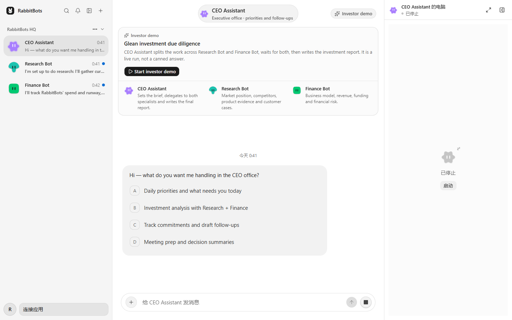

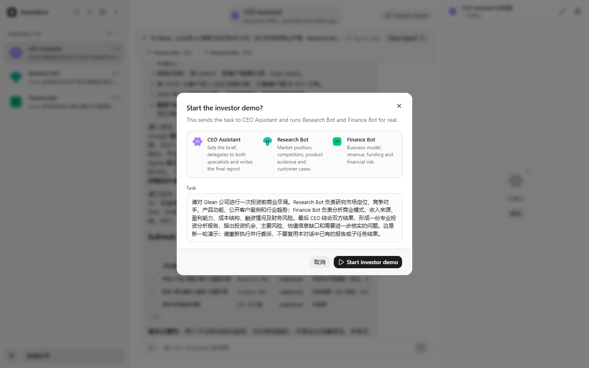

At 1024 px the right rail is replaced by the header Computer button; the demo card and free composer
remain usable.

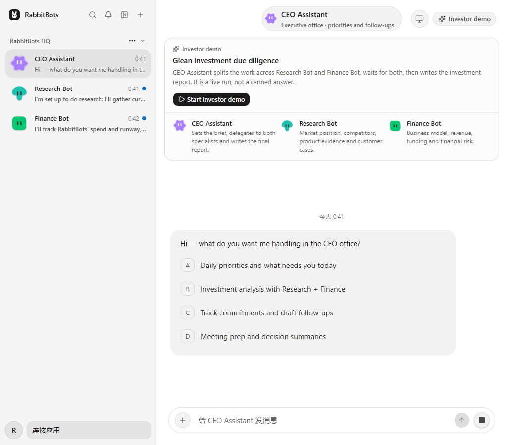

## 4. Live demo evidence

### Demo 1 — first entry run

| Item | Value |
| --- | --- |
| CEO parent Run | `cmwax3rmi00grb3t6tph0v5k0` |
| Orchestration | `cmwax6w7m00ihb3t6he4yzyn3` (completed) |
| Research Run | `cmwax6w8600inb3t61hw64kkg` |
| Finance Run | `cmwax6w8v00itb3t6k9iolemc` |
| Join Run | `cmwaxftnb00thb3t627knqsht` |
| Final report message | `cmwaxghz000tmb3t677bs82n2` |

The first demo was started from the welcome card and completed normally. Its child Runs started at
16:44:15, Finance completed at 16:50:32, Research at 16:51:12, then the Join ran. The page was
reloaded while the strip was running; the strip still showed the real child states and the run
continued.

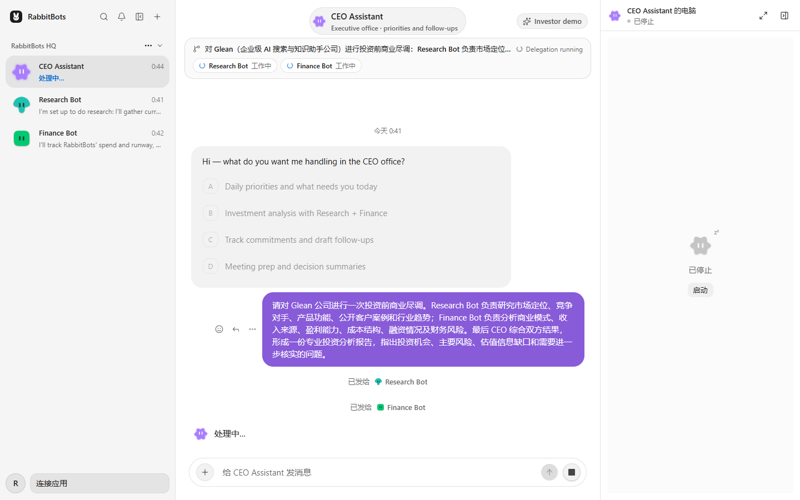

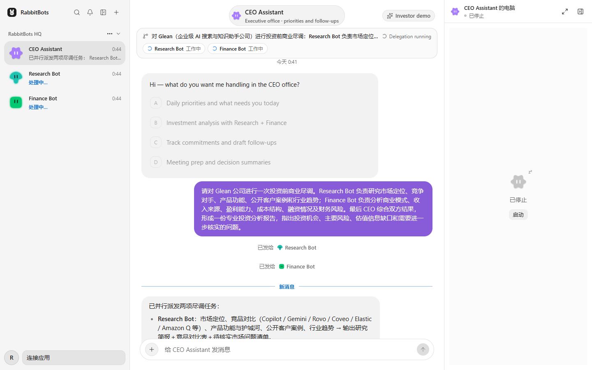

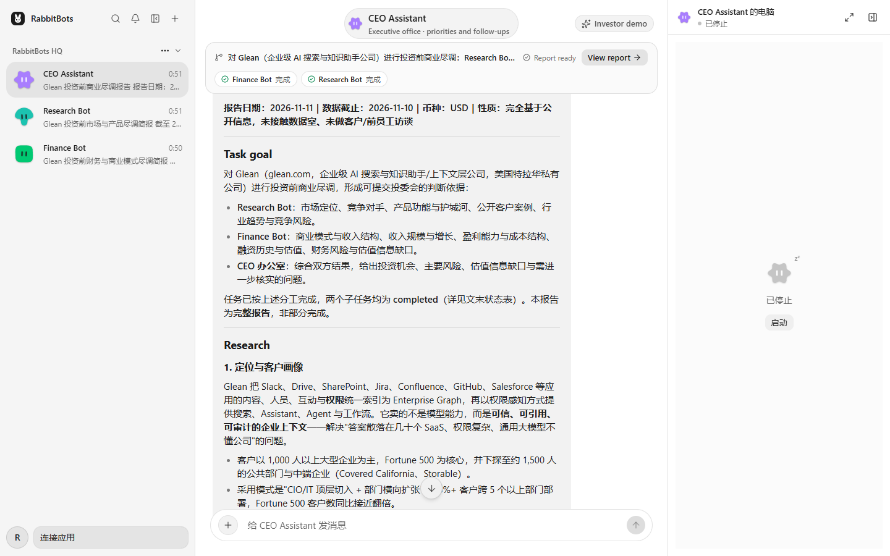

### The repeat-context bug and its fix

The first attempt to start a second demo in the same CEO thread exposed a real productization bug:
the CEO answered from the existing report instead of calling the delegation again. The Run is
`cmwaxh11z00trb3t687knczaz`; it created **no new orchestration**. This is retained in the history as
evidence of the failure, not hidden.

The demo preset was then changed to require a fresh delegation and no reuse of earlier results. The
next complete demos proved the fix.

### Demo 2 — first complete run after the guard

| Item | Value |
| --- | --- |
| CEO parent Run | `cmwaxlgvn00u6b3t61s8hgrbe` |
| Orchestration | `cmwaxlock00ucb3t65vtnhqhu` (completed) |
| Research Run | `cmwaxloda00uib3t6zsvc2v4z` |
| Finance Run | `cmwaxloef00uob3t6ami7xmlg` |
| Join Run | `cmwaxs4bp0129b3t6i62dqt0t` |
| Report message | `cmwaxszm0012cb3t64khp9zj2` |

Report opening: “本报告由两路子任务从零检索后汇总，未复用此前任何一轮的结论或数据。”

### Demo 3 — second consecutive complete run

| Item | Value |
| --- | --- |
| CEO parent Run | `cmwaxtgco012hb3t6ichllvtz` |
| Orchestration | `cmwaxtq12012nb3t68bxm6i5b` |
| Research Run | `cmwaxtq1m012tb3t6x3oncguv` |
| Finance Run | `cmwaxtq2e012zb3t6ogwqpsht` |
| Join Run | `cmway00lh01bjb3t6f971hf4k` |
| Report message | `cmway16jd01bmb3t6jtlo9ss1` |

Report opening: “对 Glean ... 进行一轮从零重新检索的投资前商业尽调” and “本报告为完整报告，非部分完成。”

Demo 2 and Demo 3 each created a new orchestration, new child Runs and a new Join. The new child
reports were labelled as a new round and independently re-fetched; the final reports explicitly say
they did not reuse earlier results. This is the verified two-consecutive-demo result.

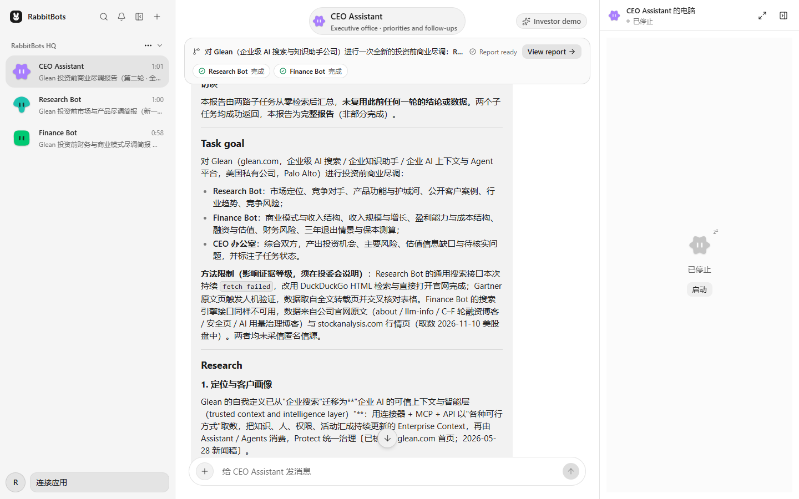

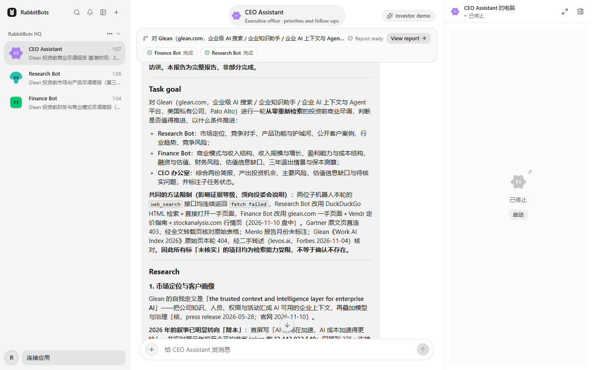

The final report is long; the new **Contents** list gives it a readable outline while preserving its
sections and tables.

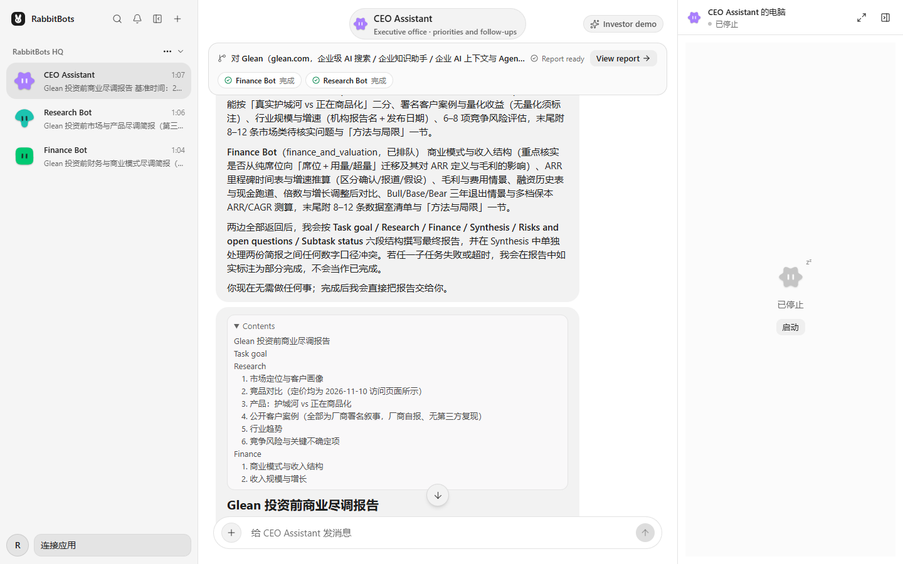

### Child chats and live Research desktop

Research delivered its report in its own chat, with numbered source URLs, access dates, and explicit
limitations (web_search fetch failures, DuckDuckGo fallback, Gartner captcha/403, vendor self-report
versus independent data). The live Computer rail shows the real browser used for the research.

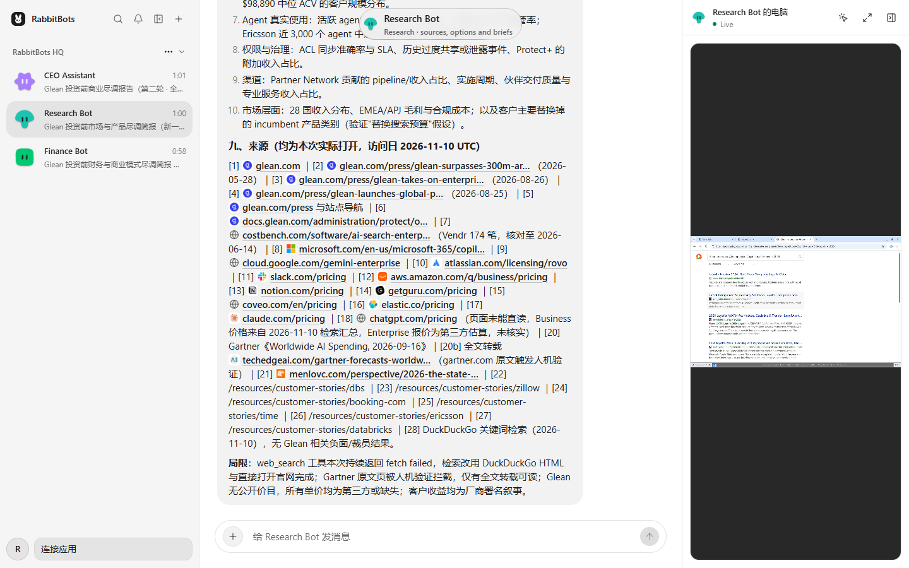

Finance delivered its own report with explicit disclosure/estimate/unknown labels. The Finance
Computer is genuinely stopped; the report does not claim a live screen it does not have.

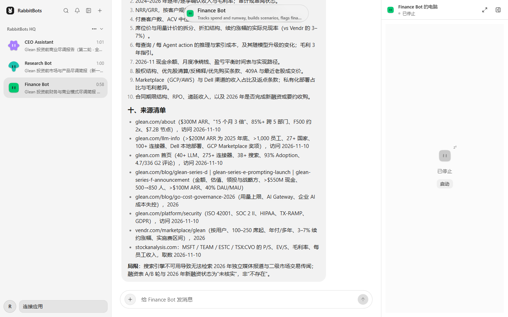

### Refresh after completion

A full browser refresh after Demo 3 restored the latest strip: **Report ready**, both children
**完成**, and the final report with its Subtask status table.

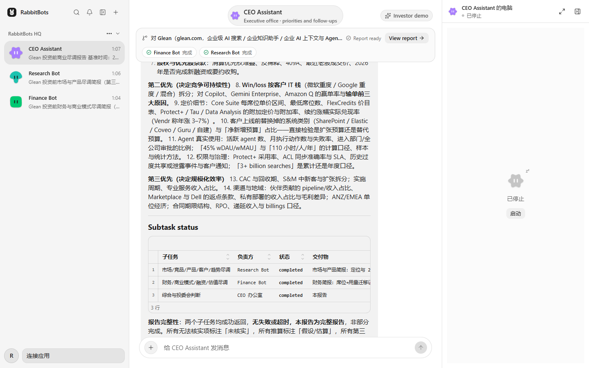

### Computer stop, restart and real screen

The Research Computer was stopped through the real stop RPC and restarted from the workspace. After
the stale-screen fix, the workspace reloaded a fresh capability and displayed the real desktop:

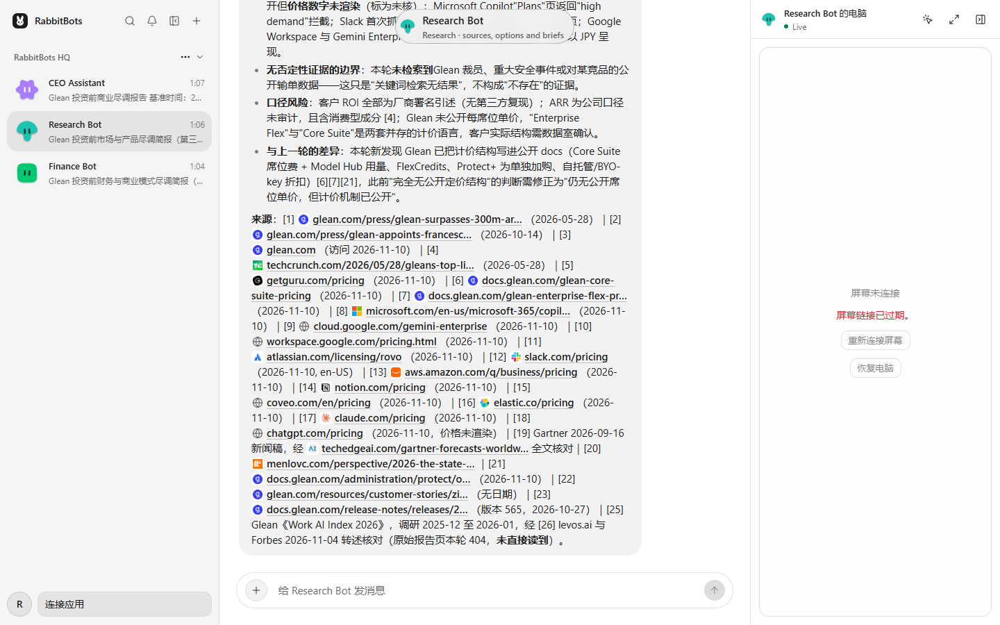

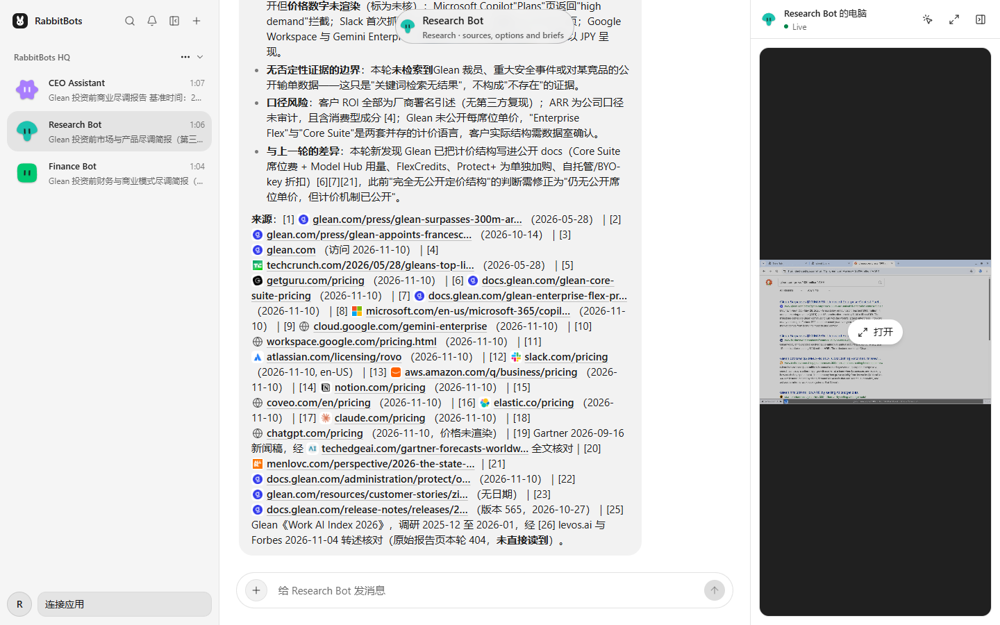

The full screen capture confirms real Chromium content on DuckDuckGo, not a placeholder:

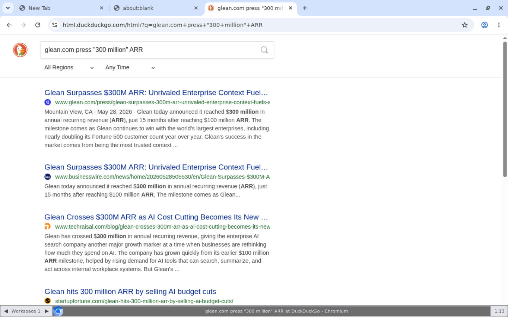

At 1024 px, the header Computer button opens the real screen overlay:

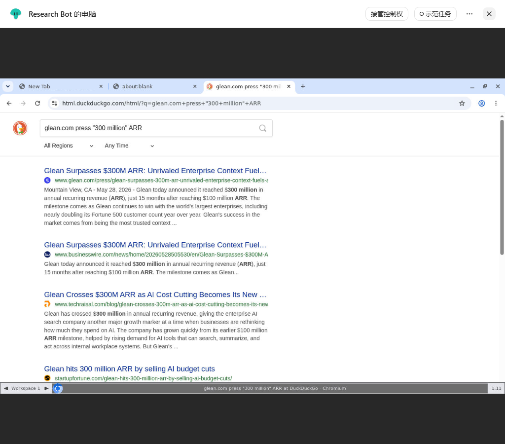

## 5. Reliability matrix

| Scenario | Result |
| --- | --- |
| Two consecutive complete demos | **PASS** — Demo 2 and Demo 3, new orchestration/children/Join each |
| History reuse after repeat | Found in `cmwaxh11z…`; fixed by the fresh-run preset; Demo 2/3 report from zero |
| Research succeeds / Finance fails | **PASS in tests** — `orchestration.postgres.test.ts` partial-report test |
| Research fails / Finance succeeds | **PASS in tests** — same partial path, failed child retained and labelled |
| Both children fail | **PASS in tests** — no invented result; Join prompt says failed |
| Child timeout | **PASS in tests** — `timed_out` marked at deadline, Join prompt exposes it |
| Duplicate events / retry | **PASS in tests** — same orchestration for same nonce; one Join after duplicate reconciliation |
| Refresh during/after run | **PASS** — Demo 1 refresh during run; Demo 3 refresh after completion |
| Computer stop/restart + real screen | **PASS** — real stop, start, fresh screen URL, Chromium content |
| Narrow layout Computer | **PASS** — 1024 px overlay opens the real desktop |
| Join count per demo | one each; 3 orchestrations / 3 Join runs overall |
| Chat isolation | separate CEO/Research/Finance threads and result messages; the CEO thread is append-only |

The 10 orchestration tests are the existing Phase 1C mechanism, not a second implementation:
3 unit tests for join-prompt failure/partial labels plus 7 PostgreSQL tests for idempotent retry,
one-join, partial, double-failure, timeout, and retry reconciliation.

## 6. Research and evidence presentation

- Research sources are shown as numbered links with access dates; failed or blocked sources are
  disclosed, not silently replaced.
- Research labels facts, third-party data, vendor claims, estimates and unknowns; the Finance report
  marks all financials as unaudited and labels estimates.
- `web_search` returned fetch failures in these runs; both bots say so and used DuckDuckGo HTML/
  browser and `web_fetch`. No bot claimed a successful search that did not happen.
- The CEO report carries the same evidence caution into the investment conclusion and lists data-room
  gaps and stop conditions.
- The long-report Contents outline is generated from the rendered headings; no report content was
  rewritten to create it.

## 7. Tests and build

| Check | Result |
| --- | --- |
| `pnpm --filter @rakazo/web check` | **passed** |
| `pnpm --filter @rakazo/web test` | **229 files / 2,030 tests passed** |
| `pnpm --filter @rakazo/web build` | **passed** (existing chunk warning) |
| `VERIFY_DATABASE=1 vitest run packages/adapters/src/orchestration.postgres.test.ts` | **10/10 passed** |
| New investor-demo tests | 5 passed |
| New report-outline tests | 3 passed |
| Timed-out strip test | passed |
| Real two-demo browser flow | completed; see Run IDs above |

No Playwright e2e run was possible on Ubuntu 20.04; the UI evidence was captured with headless
Windows Chrome against the running web app.

## 8. Files changed

New:

- `apps/web/src/pages/shell/investor-demo.tsx`
- `apps/web/src/pages/shell/investor-demo.test.tsx`
- `apps/web/src/pages/shell/message-outline.tsx`
- `apps/web/src/pages/shell/message-outline.test.tsx`
- `docs/reports/RABBITSBOTS-PHASE-1F-INVESTOR-DEMO-PRODUCTIZATION.md`
- `docs/reports/assets/phase1f-*.png`

Modified:

- `apps/web/src/pages/Shell.tsx` — demo entry/state/start wiring, header props, dialog, welcome card
- `apps/web/src/pages/shell/chat-header.tsx` — Investor demo and narrow Computer actions
- `apps/web/src/pages/shell/message-view.tsx` — report Contents for long bot answers
- `apps/web/src/pages/shell/use-computer.tsx` — clear stale screen state on restart
- `apps/web/src/pages/shell/orchestration-strip.test.tsx` — timed-out child coverage

Not modified:

- `.env`, API keys, model configuration, `infra/sandboxes/computer`, Phase 1C orchestration/join,
  Pi Agent Runtime.

`git status --short` after the phase: **110 paths — 87 modified, 23 untracked**, cumulative with
Phases 1B/1C/1D/1E. No commit and no push.

## 9. Known issues and commercialization limits

1. **Same-thread history is append-only.** The seeded account has one CEO thread. Demo 2/3 are
   functionally isolated (new orchestration/child Runs/Join, reports from zero) but their messages
   coexist with earlier reports. A true “fresh room” per demo needs a new-thread/space action. The
   preset guard prevents functional reuse; it does not erase history.
2. **Self-serve provisioning is still seed/CLI based.** A new seeded demo account works. A generic
   signup does not automatically create the CEO/Research/Finance trio; that needs a product
   provisioning flow.
3. **New UI strings are English-only** in an otherwise Chinese UI (the demo card, dialog, header
   button, Contents). Translation catalogs were intentionally not edited under the repository rule
   for feature work.
4. **`web_search` is unavailable.** Browser/web_fetch substitutes are disclosed. Financial data is
   public/third-party and unaudited; the CEO report says so.
5. **Approval cards** from real site fetches remain in the child chats; they are evidence, not
   simulated progress. The watcher auto-approved them during the demo.
6. **The failed repeat run remains in the account history** (`cmwaxh11z…`); the two complete demos
   after the fix are the verified consecutive results.
7. **Live partial/failure/timeout is not a production scenario run.** The paths are verified by the
   10 PostgreSQL/unit tests; the live runs were both-success.
8. **CEO/Finance Computers are stopped**; only Research is live. The right rail shows the real
   current state instead of substituting a screen.
9. Playwright e2e remains unavailable on this host.

## 10. Verdict

### PASS

- New seeded account can enter the complete demo from the visible entry.
- One action starts the real CEO / Research / Finance collaboration.
- Two consecutive complete demos after the guard have independent Run IDs and reports that state
  they re-fetched from zero.
- The successful path ran for real; partial/failure/timeout/idempotency paths pass the orchestration
  tests.
- Join is idempotent: one Join per orchestration, no duplicate.
- Refresh restores child status and the final report.
- Computer can stop, start, and display a real desktop; narrow screens can open it.
- Reports show evidence grades, source URLs, dates, failed-source disclosures, tables and an
  in-report Contents outline.
- Web check, 2,030 tests and the build pass.

### NOT TESTED

- A live partial-failure or timeout production demo (the orchestration tests cover the logic).
- A genuinely fresh thread/space per demo; the implementation is prompt-guarded same-thread.
- Self-serve provisioning for arbitrary signups.
- Playwright e2e on Ubuntu 20.04.

### BLOCKED

- None for the MVP investor demo. The remaining items are product/operations limitations, not
  execution blockers.

## 11. Revalidation after the later dev-stack restart

On 2026-11-11 12:06 UTC+8, after the development stack had been stopped and restarted, the existing
Phase 1F implementation was revalidated without reimplementing it:

- Git remained `main` at `6c7e1bcc6`; `git status --short` remained **110 paths** (87 modified,
  23 untracked).
- Web/API/Supervisor and the branch database were back online; the demo account and the Demo 1/2/3
  orchestrations, child Runs and Join records were still present.
- `pnpm --filter @rakazo/web check` passed; `pnpm --filter @rakazo/web test` passed with
  **229 files / 2,030 tests**; the web build passed.
- `orchestration.postgres.test.ts` passed **10/10** again.
- The current CEO page still showed the **Investor demo** header entry, the latest strip **Report
  ready** with both children **完成**, the confirmation dialog with the fresh-run guard, and four
  report outline entries on the long reports.

This revalidation used the existing implementation and data; it did not rerun the two full demos or
modify the code. The original live demo evidence and Run IDs above remain valid.